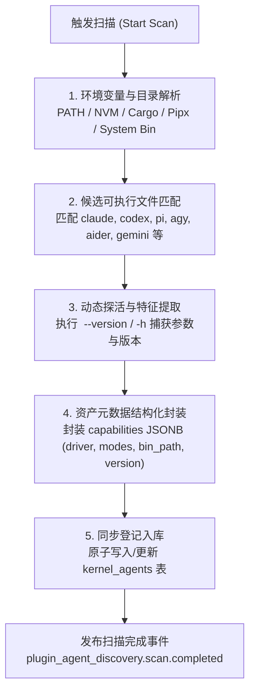
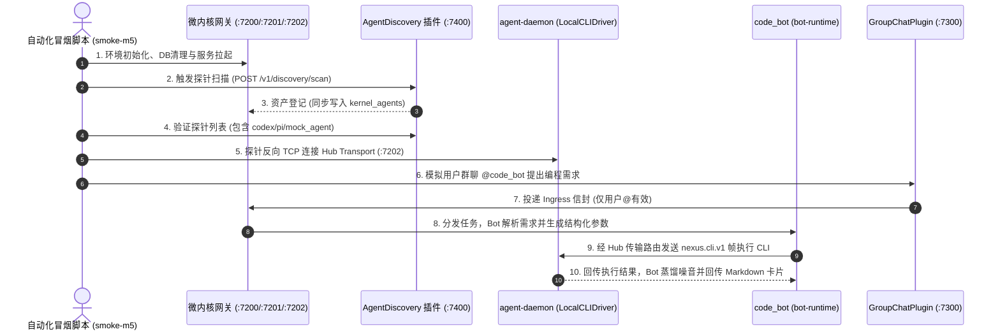

# M5 阶段详细设计定版：本地 Agent 搜寻与受控调度闭环

> **阶段代号**：M5（Local Agent Discovery & Controlled Dispatching Loop）  
> **文档状态**：正式定版（Approved & Finalized）  
> **编制日期**：2026-11-15  
> **核心战略**：打通宿主机既有 AI 资产（Claude Code / Codex / Pi-Agent / Antigravity CLI 等），让 NexusCore 具备搜寻外部 Agent 并在 Bot 协同下调度执行的能力。**严格恪守脑手分离与安全边界：用户绝不直接与混乱的 CLI 通话**，而是由专职 Bot 将用户模糊需求结构化后经 Hub 传输路由反向调度探针执行，并将底层原始输出进行防噪音蒸馏（Anti-Noise Distillation），提炼核心摘要结构化回显给用户。

---

## 1. 业务背景与设计理念

### 1.1 为什么需要 M5？
在 M1~M4 阶段，NexusCore 顺利完成了微内核底座（M1）、配置中心与两级进程模型（M2）、单体记忆与群聊插件（M3）以及 Vue 3 工作台实机演示（M4）。在 M4 演示中，Bot 操控的探针仅为执行 `nexus.echo.v1` 协议的冒烟夹具（`loopback_agent`）。

在现实开发环境中，宿主机往往已经预装了强大的专业 Coding Agent CLI，例如：
- **Claude Code** (`claude`)：Anthropic 官方编码助手，支持非交互 `-p` 提示模式与架构化执行；
- **Codex CLI** (`codex`)：本地代码索引与脚本生成工具；
- **Pi-Agent** (`pi`)：超轻量 Coding Agent，支持流式任务处理；
- **Google Antigravity CLI** (`agy`)：DeepMind 全栈 Agent CLI 工具链；
- **Aider** (`aider`)：git 级代码自动补齐与结对编程 CLI。

如果 NexusCore 重新造一套庞大的代码修改与环境交互工具，不仅冗余庞大，而且违背了“微内核做连接与路由，业务靠生态插件与专业工具”的初衷。**M5 的核心使命就是让 NexusCore 成为本地多种专业 Agent 的调度与协同中枢。**

### 1.2 核心设计理念与铁律边界

```
[人类用户 / Web UI] ──自然语言@──> [GroupChat / Ingress]
                                          │
                                          ▼
                         [专职 Bot (如 code_bot)]
                         - 角色设定 & Prompt
                         - Claude Code 单体记忆 (MEMORY.md ≤200行)
                         - 模糊意图转化为精准结构化任务参数
                                          │ (gRPC / Hub 路由)
                                          ▼
                         [Hub Transport Router (:7202)]
                                          │ (反向 TCP Frame)
                                          ▼
                         [agent-daemon 物理探针]
                         - LocalCLIDriver (本地 CLI 驱动)
                         - 进程组隔离 (Setpgid / setsid)
                         - 硬超时封顶 (30s~120s)
                         - 标准管道拉起目标 CLI (claude/codex/pi 等)
                                          │
                                          ▼ (原始 stdout/stderr/diff)
                         [Bot 噪音蒸馏器 (Anti-Noise Distiller)]
                         - 剔除进度条/ANSI色彩/冗余日志
                         - 提炼关键结论、修改文件、执行耗时
                                          │
                                          ▼ (精选 Markdown 卡片)
[人类用户 / Web UI] <──纯文本回复───────┘
```

1. **脑手分离（Brain-Hand Separation）**：
   - **Bot 是脑（Simple Agent）**：负责意图理解、参数结构化、上下文关联与结果提炼。Bot 自身**严禁执行 Shell，严禁包含任何环境与物理执行权限**。
   - **Agent-Daemon 是手（Physical Probe）**：受控的物理执行器，驻留在真实宿主或目标执行设备中，通过反向 TCP 接入 Hub，只接受经 Hub 授权与传输的结构化执行帧。
2. **用户不直连 CLI（No Direct Terminal Access）**：
   - 底层 CLI（如 Claude Code / Codex）输出冗长、伴随终端色彩码、动态 Spinner 与交互等待；
   - 用户全程只面对 Bot 生成的结构化响应卡片，杜绝终端混乱。
3. **结构化双向转换**：
   - **上行（输入结构化）**：自然语言需求 $\rightarrow$ 专职 Bot 结合记忆提炼 $\rightarrow$ `TargetCLI + Args + Prompt + WorkingDir + Timeout`；
   - **下行（输出精选化）**：原始终端混合流 $\rightarrow$ 噪音清洗与关键状态蒸馏 $\rightarrow$ 格式化 Markdown 卡片。
4. **两级进程规范（L1 Bot + L2 插件服务）**：
   - 搜寻功能独立封装为 `plugin_agent_discovery`（L2 二进制）；
   - 由 Owner Bot `discovery_bot`（L1 进程）自治拉起与监控，资产入库与状态上报遵从微内核规范。

---

## 2. 总体架构与模块划分

M5 由三大核心模块构成：

| 模块名 | 源码位置 | 运行形态 | 核心职责 |
| --- | --- | --- | --- |
| **本地 Agent 搜寻插件**<br/>(`plugin_agent_discovery`) | `plugins/plugin_agent_discovery/` | 独立 L2 插件二进制 | 扫描宿主机 PATH 与全局包管理器目录；识别与探测主流 Coding Agent CLI；提取版本与运行模式；同步至 `kernel_agents` 表；提供探测 API。 |
| **探针本地 CLI 驱动**<br/>(`LocalCLIDriver`) | `agent-daemon/driver/` | 物理探针内置驱动 | 实现 `nexus.cli.v1` 传输协议；非交互管道拉起 CLI；进程组隔离与强制超时退出；流式收集 stdout/stderr；截断保护。 |
| **Bot 结构化调度与蒸馏器**<br/>(`Bot CLI Dispatcher`) | `bot-runtime/` | Bot 简单 Agent 核心扩展 | 将用户模糊需求转化为 CLI 结构化参数；通过 Hub 传输路由反向调度探针；对回传的大日志进行高信噪比蒸馏；生成 Markdown 卡片并写入 Transcripts。 |

---

## 3. 本地 Agent 搜寻插件详细设计 (`plugin_agent_discovery`)

### 3.1 清单契约 (`manifest.json`)
遵循 `nexus-plugin-dev` 技能规范与 Manifest Schema 强校验规则：

```json
{
  "plugin_id": "plugin_agent_discovery",
  "name": "Local Agent Discovery Plugin",
  "version": "1.0.0",
  "plugin_type": "executor",
  "description": "本地宿主机 Coding Agent 资产自动探测、版本萃取与登记插件",
  "binary": "/home/yhy/Projects/NexusCore/bin/plugins/plugin_agent_discovery",
  "publishing": [
    "plugin_agent_discovery.agent.discovered",
    "plugin_agent_discovery.scan.completed"
  ],
  "subscribing": [
    "bot.command.scan_agents"
  ],
  "providing_tools": [
    "agent_discovery.scan_now",
    "agent_discovery.list_agents",
    "agent_discovery.probe_agent"
  ],
  "requiring_tools": [],
  "bot_templates": [
    {
      "bot_id": "discovery_bot",
      "role": "plugin",
      "display_name": "Agent Discovery Bot",
      "activation_mode": "resident",
      "capabilities": [
        "agent_discovery",
        "asset_management"
      ]
    }
  ],
  "schema_version": 1,
  "binary_digest": ""
}
```

### 3.2 搜寻算法与探测 Heuristics

`plugin_agent_discovery` 在启动或接收到扫描指令时，执行以下三步探测：



#### 探测候选矩阵与运行模式定义：
1. **Claude Code (`claude`)**：
   - 探活命令：`claude --version`
   - 支持模式：`pipe`、`non_interactive`（参数 `-p "<prompt>" --print`）
   - 提取特征：版本号（如 `Claude Code 0.2.x`）
2. **Codex CLI (`codex`)**：
   - 探活命令：`codex --version`
   - 支持模式：`non_interactive`（参数 `exec "<prompt>"` 或非交互模式）
   - 提取特征：`codex-cli 0.154.0`
3. **Pi-Agent (`pi`)**：
   - 探活命令：`pi --version`
   - 支持模式：`pipe`、`cli`（参数 `-p "<prompt>"`）
   - 提取特征：版本号（如 `0.85.1`）
4. **Google Antigravity CLI (`agy`)**：
   - 探活命令：`agy --version`
   - 支持模式：`non_interactive`
5. **Mock Agent CLI (`nexus-mock-agent`)**：
   - 专门用于单元测试与端到端自动化冒烟测试（`smoke-m5`）的受控 CLI，保证测试可确定性与无外部 API 依赖。

### 3.3 数据模型与 `kernel_agents` 资产入库
遵守微内核约束，不改动 `kernel_agents` 表结构字段集合，将扩展特征全部收敛至 `capabilities` JSONB 字段中：

```json
{
  "driver": "local_cli",
  "bin_name": "codex",
  "bin_path": "/home/yhy/.nvm/versions/node/v22.23.1/bin/codex",
  "version": "0.154.0",
  "modes": ["non_interactive", "pipe"],
  "prompt_flag": "-p",
  "env_vars": {
    "TERM": "dumb",
    "NO_COLOR": "1"
  },
  "max_timeout_sec": 60,
  "detected_at": "2026-11-15T13:10:00Z"
}
```

### 3.4 HTTP REST 接口
插件独立暴露轻量 HTTP 端口（`:7400`）：
- `GET /v1/discovery/agents`：获取所有探测到的本地 Agent 资产列表；
- `POST /v1/discovery/scan`：触发即时重扫，返回新发现与更新资产数量；
- `POST /v1/discovery/probe`：单点指定路径探活测试。

---

## 4. `agent-daemon` 本地 CLI 适配执行驱动 (`LocalCLIDriver`)

### 4.1 协议规范：`nexus.cli.v1`
当 Bot 通过 Hub 传输路由向 `agent-daemon` 发起执行时，使用专用传输子协议 `nexus.cli.v1`。

#### 请求负载 (`OpenRequest.Payload` / `FrameData`):
```json
{
  "command": "codex",
  "args": ["-p", "写一个斐波那契数列计算函数"],
  "working_dir": "/tmp/nexus_workspace",
  "timeout_sec": 30,
  "env": {
    "NO_COLOR": "1",
    "CI": "true"
  },
  "job_id": "job_01j7x0..."
}
```

#### 响应负载 (`FrameData` 应答):
```json
{
  "exit_code": 0,
  "stdout": "```go\nfunc Fib(n int) int {\n...",
  "stderr": "",
  "elapsed_ms": 1420,
  "job_id": "job_01j7x0...",
  "agent_id": "local_agent_daemon",
  "truncated": false
}
```

### 4.2 驱动安全执行保障机制
`LocalCLIDriver` 内部实现四重物理安全防线：
1. **命令白名单与二进制路径归一化**：
   - 仅允许执行经过 `plugin_agent_discovery` 登记或配置中心白名单允许的 CLI 二进制，严禁执行任意原生 Shell 脚本（如 `rm -rf`、`curl | bash`）；
   - 使用 `filepath.Clean` 与绝对路径执行，规避环境变量劫持。
2. **硬超时与孤儿清理（Context Timeout & Process Group）**：
   - 执行时默认超时封顶 30s（最高不得超过 120s）；
   - 创建进程时显式开启独立进程组：
     ```go
     cmd.SysProcAttr = &syscall.SysProcAttr{Setpgid: true}
     ```
   - 一旦超时或收到取消信号，首先向进程组发送 `SIGTERM`（`syscall.Kill(-cmd.Process.Pid, syscall.SIGTERM)`），等待 1.5 秒后若未退出则强发 `SIGKILL`，杜绝任何 CLI 产生驻留后台死锁进程。
3. **输出缓冲区硬截断（Buffer Capping）**：
   - 单次 stdout/stderr 最大捕获上限设为 **1 MB**；
   - 超过 1 MB 时进行平滑截断，标记 `truncated: true` 并附带说明 `[NexusCore: Output truncated at 1MB]`，杜绝内存耗尽与总线信封爆裂。
4. **ANSI 终端色彩清洗与转义**：
   - 过滤终端光标控制字符与动态旋转 Spinner 进度码，保障纯净文本输出。

---

## 5. Bot 结构化调度与防噪音蒸馏闭环 (`bot-runtime`)

### 5.1 结构化输入转换（意图 $\rightarrow$ CLI 提示词）
简单 Agent 遵从极简提示词框架，当收到群聊用户的模糊需求时：
- **用户输入示例**：“@code_bot 帮我用 Go 写一个支持并发安全的 Counter”；
- **Bot 结构化转换**：
  1. 检索自身单体记忆 `MEMORY.md`（约束 ≤200 行，提取用户编码偏好与项目规范）；
  2. 生成紧凑、精确的目标 Agent 指令；
  3. 组装 `nexus.cli.v1` 请求，指定目标 CLI（如 `codex` 或 `claude`）及非交互参数。

### 5.2 防噪音蒸馏器算法（Anti-Noise Distillation）
底层 Agent CLI 的原始回显通常包含大量非结构化噪音，例如：
```text
[Claude Code initializing...]
Loading context from git repo (342 files)...
[========================================] 100%
Thinking (elapsed 1.2s)...
Here is the code you requested:
```go
package counter
...
```
Done in 2.1s. 1 file modified.
```

Bot 内部的蒸馏器执行高信噪比提炼：
1. **正则剔除日志噪音**：剥离 `Loading context...`、进度条 `[===]`、`Thinking...`、`Claude Code initializing` 等状态信息；
2. **状态与耗时萃取**：提取 `exit_code`、`elapsed_ms` 以及改动文件行数；
3. **生成 Markdown 结构化卡片**：
   ```markdown
   [code_bot 响应] 需求处理完成
   - **调用探针**: `local_agent_daemon` (执行器: `codex`)
   - **执行状态**: 成功 (耗时: 1.42s)
   - **核心交付物**:
   ```go
   type SafeCounter struct {
       mu sync.RWMutex
       val int
   }
   ...
   ```
   - **单体记忆**: 已同步至会话流水 (Transcripts)
   ```

---

## 6. 端到端自动化验收方案 (`smoke-m5`)

构建全自动化、确定性、高覆盖率的冒烟脚本 `scripts/smoke-m5.sh`，并在 `Makefile` 中集成 `make smoke-m5`。

### 6.1 10 步冒烟验证拓扑



### 6.2 验收判定准则（Pass Criteria）
1. **资产探测入库**：`plugin_agent_discovery` 正确识别宿主机环境中的 CLI（包括已装的 `codex`、`pi` 以及测试夹具 `mock_agent`），`kernel_agents` 表正确更新且 `status = 'online'`；
2. **安全隔离与超时**：注入故意的长时间睡眠命令（如 `sleep 10` 并设超时 2s），验证 `LocalCLIDriver` 在 2 秒内准确截断并杀死整个进程组，无孤儿进程残留；
3. **输出蒸馏完整性**：Bot 回复中包含精炼后的代码块与执行状态，绝无原始 Spinner 进度条与终端 ANSI 字符泄漏；
4. **因果链完整闭环**：回复消息携带完整的因果追踪头（`root_envelope_id`、`correlation_id`、`causation_id`），会话流水合规写入 Bot 单体记忆 `Transcripts`；
5. **回归测试全绿**：`make test`、`make vet`、`make smoke-m1`、`make smoke-m2`、`make smoke-m3`、`make smoke-m4`、`make smoke-m5` 全部 100% 通过。
