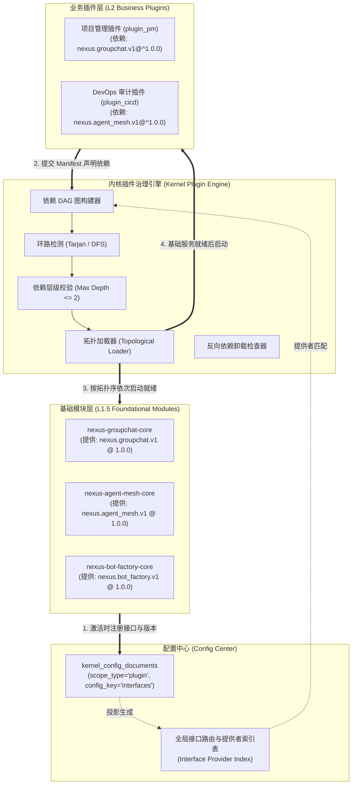
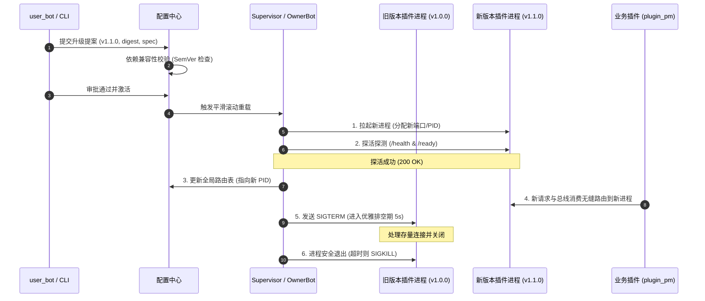

# M8 详细设计定版：插件接口注册、依赖治理与安全生命周期方案

> **文档状态**：正式定版归档（Approved & Finalized）  
> **定版日期**：2026-11-15  
> **设计主题**：在 M8 基础模块无头化沉淀的基础上，建立微内核统一的**能力/接口注册机制**、**面向契约的依赖声明与拓扑排序加载**，以及完备的**循环依赖拦截、依赖层级限制（Max Depth ≤ 2）、逆序安全卸载与平滑热更新体系**。

---

## 1. 架构动机与问题背景

在 M8 之前，NexusCore 的插件依赖模型相对静态：
- 插件的 `deps` 仅为扁平的字符串数组，未定义版本约束规则；
- 插件之间缺乏标准化的**能力契约（Interface Contract）**定义，业务插件直接耦合具体实现；
- 插件加载缺乏严格的依赖拓扑序，若依赖的基础服务尚未就绪即启动业务插件，极易产生连接拒绝或初始化失败；
- 缺乏依赖环路检测、层级深度限制与安全卸载校验，面临“循环依赖死锁”、“深层依赖地狱”与“基础插件被误删导致下游级联雪崩”等隐患。

为此，**M8-Update 提出四大核心机制**：
1. **接口能力入配置中心**：基础模块在配置中心注册接口契约与 SemVer 版本标识；
2. **面向接口契约依赖**：业务插件清单声明所需接口与版本范围，内核按 DAG 拓扑排序顺序加载；
3. **依赖安全刚性防线**：环路静态检测（Cycle Detection）+ 最大层级深度硬约束（Max Depth = 2）；
4. **生命周期闭环**：反向依赖安全卸载（逆序级联停机）+ 兼容版本两阶段平滑热更新。

---

## 2. 总体架构拓扑与交互模型



---

## 3. 详细设计方案

### 3.1 基础插件能力与接口在配置中心中的注册（版本标识）

#### 3.1.1 存储模型映射（恪守配置中心规范）
依据微内核架构规范，配置中心仅允许 `plugin / bot / agent / global` 四类 `scope_type`，且禁止内核存储业务数据。  
基础模块暴露的能力接口完全属于插件能力范畴，因此统一注册在：
- **`scope_type`**：`"plugin"`
- **`scope_id`**：`"<plugin_id>"`（如 `"plugin_groupchat"`）
- **`config_key`**：`"interfaces"`
- **`version`**：单调递增版本号（由配置中心版本控制系统维护）

#### 3.1.2 接口契约元数据 Schema 定义
配置中心存储的 `interfaces` 配置文档结构如下：

```json
{
  "plugin_id": "plugin_groupchat",
  "plugin_version": "1.0.0",
  "provides_interfaces": [
    {
      "interface_id": "nexus.groupchat.v1",
      "version": "1.0.0",
      "protocol": "http_rest",
      "endpoint": "http://127.0.0.1:7300/v1/chat",
      "health_check": "http://127.0.0.1:7300/v1/chat/health",
      "capabilities": [
        "room_lifecycle",
        "message_routing",
        "user_mention_dispatch"
      ],
      "methods": [
        { "name": "CreateRoom", "path": "/v1/chat/rooms", "method": "POST" },
        { "name": "PostMessage", "path": "/v1/chat/rooms/{room_id}/messages", "method": "POST" },
        { "name": "GetHistory", "path": "/v1/chat/rooms/{room_id}/messages", "method": "GET" }
      ],
      "stability": "stable"
    }
  ]
}
```

#### 3.1.3 核心 Go 结构体定义

```go
package plugin

// InterfaceDefinition 基础插件暴露的接口契约
type InterfaceDefinition struct {
    InterfaceID  string   `json:"interface_id"`  // 接口唯一标识，如 "nexus.groupchat.v1"
    Version      string   `json:"version"`       // 语义化版本，如 "1.0.0"
    Protocol     string   `json:"protocol"`      // "http_rest" | "grpc" | "transport_frame"
    Endpoint     string   `json:"endpoint"`      // 监听地址或 UNIX Domain Socket
    HealthCheck  string   `json:"health_check"`  // 探活 URI
    Capabilities []string `json:"capabilities"`  // 细分能力特性标签
    Stability    string   `json:"stability"`     // "alpha" | "beta" | "stable"
}

// PluginInterfacesDoc 配置中心存储的规范文档
type PluginInterfacesDoc struct {
    PluginID           string                `json:"plugin_id"`
    PluginVersion      string                `json:"plugin_version"`
    ProvidesInterfaces []InterfaceDefinition `json:"provides_interfaces"`
}
```

#### 3.1.4 注册与投影机制
1. 基础插件在完成安全审查并通过 `user_bot` 审批激活时，将其接口清单写入配置中心；
2. 内核监听 `kernel.config.changed` 事件，将各基础插件的 `interfaces` 投影至内存中的 **全局接口提供者索引表（Interface Provider Index）**：
   - 键：`InterfaceID`（如 `nexus.groupchat.v1`）；
   - 值：`[]ProviderEntry{ PluginID, Version, Endpoint, Status }`；
3. 支持多版本共存与语义化范围匹配。

---

### 3.2 业务插件依赖声明与拓扑排序加载

#### 3.2.1 业务插件清单依赖声明规范（Manifest v2）
业务插件的 `manifest.json` 采用面向接口契约的方式声明依赖，**严禁硬编码依赖具体的插件二进制文件**：

```json
{
  "plugin_id": "plugin_pm",
  "name": "Project Management Plugin",
  "version": "1.0.0",
  "plugin_type": "workspace",
  "schema_version": 2,
  "dependencies": [
    {
      "interface": "nexus.groupchat.v1",
      "version_range": "^1.0.0",
      "optional": false,
      "reason": "需要调用群聊模块在任务看板内发起多 Bot 协同讨论"
    },
    {
      "interface": "nexus.agent_mesh.v1",
      "version_range": ">=1.0.0 <2.0.0",
      "optional": true,
      "reason": "可选依赖：调度本地代码分析探针"
    }
  ],
  "bot_templates": [ ... ]
}
```

#### 3.2.2 依赖契约结构体

```go
// DependencySpec 业务插件声明的接口依赖
type DependencySpec struct {
    Interface    string `json:"interface"`     // 依赖的目标接口名
    VersionRange string `json:"version_range"` // SemVer 范围语法，如 "^1.0.0", ">=1.2.0"
    Optional     bool   `json:"optional"`      // 是否为可选依赖
    Reason       string `json:"reason"`        // 引入依赖的业务诉求与说明
}
```

#### 3.2.3 接口解析与依赖图（DAG）构建
内核在启动或插件安装审核阶段，遍历系统内已激活的插件清单：
1. 针对业务插件的每个 `DependencySpec`，在全局接口提供者索引表中检索满足 `VersionRange` 的提供者；
2. 若存在多个满足条件的提供者，优先选取最高兼容版本（若存在冲突需报告歧义）；
3. 若非可选依赖（`Optional == false`）未找到可用提供者，直接抛出 `ErrUnmetDependency` 并阻断加载；
4. 解析成功后，在内存中生成依赖有向图：
   - **顶点（Vertices）**：插件集合 $\{P_1, P_2, \dots, P_n\}$；
   - **有向边（Edges）**：$P_i \to P_j$（表示 $P_i$ 依赖 $P_j$，$P_j$ 必须先于 $P_i$ 启动）。

#### 3.2.4 拓扑排序加载算法（Topological Sort Loader）
采用标准的 **Kahn 算法** 计算加载拓扑序列：
1. 统计每个顶点的入度（In-degree，即被其他哪些基础模块依赖，此处将依赖方向定义为 $Provider \to Consumer$，或从无依赖的底层向顶层展开）；
2. 首先加载并激活入度为 0 的基础插件（即不依赖其他任何插件的基础无头模块，如 `plugin_groupchat`, `plugin_agent_mesh`）；
3. 基础插件启动并经健康探活端点（`/health`）探测就绪后，标记该节点就绪，入度减 1；
4. 依次加载后续业务插件（如 `plugin_pm`、`plugin_cicd`）；
5. 保证系统在启动或批量恢复时，任何业务插件初始化时其依赖的基础服务 100% 已经处于可用状态。

---

### 3.3 安全、依赖治理、卸载与热更新

#### 3.3.1 循环依赖检查（Cycle Detection）
- **触发时机**：插件清单审查阶段（Security Review）、配置提案阶段、系统启动建图阶段；
- **算法实现**：采用 **三色标记法（White-Gray-Black DFS）** 或 Tarjan 强连通分量算法扫描有向图；
  - 白色：尚未访问的节点；
  - 灰色：当前 DFS 递归调用栈中的节点（正在遍历其后继）；
  - 黑色：已完全遍历且确认无环的节点。
- **阻断行为**：
  - 遍历过程中若遇到灰色节点，立即判定存在回路（Directed Cycle）；
  - 提取递归栈中的回路路径，输出清晰友好的诊断信息：
    ```text
    [SECURITY_ERROR] 发现非法循环依赖环路: 
    plugin_pm -> plugin_collab -> plugin_task -> plugin_pm
    提案已被 security_bot 强行阻断，禁止激活。
    ```
  - **结论**：杜绝因循环依赖引发的死锁、启动阻塞和内存泄漏。

#### 3.3.2 依赖层级检查（Dependency Depth / Level Check）
为了杜绝微服务架构中常见的“深层依赖地狱（Dependency Hell）”及调用链级联抖动，微内核实施硬性层级防线：
- **最大依赖深度限制**：`MaxDependencyDepth = 2`（硬限制）；
  - **Level 0**：Kernel Hub 微内核底座（队列、Supervisor、Transport、配置中心）；
  - **Level 1 (L1.5)**：沉淀的基础无头模块（`nexus-groupchat-core`, `nexus-agent-mesh-core` 等），**仅依赖 Level 0**，不可依赖任何业务插件；
  - **Level 2 (L2)**：垂直业务插件（`plugin_pm`, `plugin_notes`, `plugin_cicd`），**仅允许依赖 Level 1 基础模块**；
  - **禁止 Level 3+**：业务插件之间严禁跨层形成纵向长调用链（若业务插件间需要协作，必须通过微内核持久总线事件或项目公共数据，禁止同步进程硬依赖）；
- **校验算法**：在有向无环图上使用关键路径（Longest Path）算法，若从任意业务节点到叶子节点的深度 $> 2$，直接判定违规并抛出 `ErrExceedsMaxDependencyDepth`。

#### 3.3.3 安全卸载与逆序级联停机（Safe Teardown & Cascading）
当用户或管理员试图停用或卸载某个插件时，执行严密的反向依赖检查：
1. **反向引用校验（Reverse Dependency Check）**：
   - 检查当前依赖图，扫描是否有处于 `active` 或 `running` 状态的其他插件正在消费该插件提供的接口；
2. **常规卸载（拒绝模式，默认行为）**：
   - 若存在上游依赖者，操作立即被拒绝，返回 HTTP 409 Conflict，提示：
     ```text
     无法卸载基础插件 plugin_groupchat：
     仍有 2 个业务插件依赖该模块提供的 [nexus.groupchat.v1] 接口：
     - plugin_pm (Running)
     - plugin_cicd (Active)
     请先停用或卸载依赖方业务插件。
     ```
3. **强制级联卸载（显式 `--cascade` 确认）**：
   - 仅在由 `user_bot` 在真实交互终端输入显式确认后方可执行；
   - 采用 **逆拓扑排序（Reverse Topological Order）** 顺序执行受控下线：
     1. 首先向顶层业务插件 `plugin_pm` 发送优雅停机信号并注销；
     2. 确认上游已彻底停机且进程回收；
     3. 最后停用并注销基础插件 `plugin_groupchat`；
   - 杜绝野指针调用与运行时连接悬挂。

#### 3.3.4 平滑滚动热更新（Rolling Hot Update Strategy）
当基础插件发布新版本时，微内核提供基于两级进程模型的高可用平滑更新机制：



1. **版本兼容性预审（SemVer Compatibility Pre-flight）**：
   - **Patch / Minor 升级**（如 `v1.0.0 -> v1.0.1` 或 `v1.0.0 -> v1.1.0`）：由于 SemVer 规则保证向前兼容，自动通过；
   - **Major 升级**（如 `v1.0.0 -> v2.0.0`）：检查所有依赖该接口的活跃插件的 `version_range`。若存在无法匹配 `^2.0.0` 的业务插件，**系统直接阻断升级提案**，给出不兼容告警；
2. **两阶段蓝绿/滚动拉起（Blue-Green Rolling for L2）**：
   - Step 1: Owner Bot 先行启动新版本二进制进程，分配新临时端口或新 UNIX Domain Socket；
   - Step 2: 对新进程进行连续 3 次健康检查（`GET /health` 返回 200）；
   - Step 3: 原子切换内存路由表与总线 Consumer 委托，新流量立即由新进程承接；
   - Step 4: 向旧进程发送 `SIGTERM`，预留 5 秒连接排空窗口（Drain Period）；
   - Step 5: 旧进程处理完存量任务后正常退出，Supervisor 回收登记，完成毫秒级无感热更。

---

## 4. 方案对 NexusCore 架构硬约束的遵从性自查（供用户审计）

| 约束条目 (摘自 AGENTS.md) | 本方案遵从性设计与实现机制 | 自查判定 |
| :--- | :--- | :---: |
| **内核三原语边界** | 配置中心依然只存储 `plugin / bot / agent / global` 期望配置；接口契约以 `scope_type='plugin'` 归档；内核不承载具体业务协议解析，仅负责路由与拓扑排序调度。 | **合规** |
| **总线信封与因果链** | 依赖关系仅用于进程启动顺序与接口寻址，业务插件在总线上的通信依然遵循 Ingress 信封、因果链与单次委托，无任何特权通道。 | **合规** |
| **脑手分离** | 接口注册与依赖加载属于控制面管理，Bot 运行时依然严禁直接执行本地 Shell，物理命令依然只能调度到受控探针。 | **合规** |
| **两级进程模型** | 基础模块与业务插件的 L2 进程依然由其 owner bot 负责拉起与自治上报，强制终止与孤儿级联回收依然归属于微内核 Supervisor。 | **合规** |
| **配置中心审批流** | 接口注册文档与升级更新均通过标准的 `Propose -> Security Review -> user_bot Approve -> Activate` 流程，禁止 Bot 自批。 | **合规** |
| **零 UI 约束** | 接口定义中只包含 HTTP REST/gRPC/Transport 契约与 Schema，无任何前端模板与视图残留。 | **合规** |

---

## 5. 后续落地与验收路径建议

1. **配置中心 Schema 补充**：完善 `scope_type='plugin'` 下 `config_key='interfaces'` 的 JSON Schema 校验器；
2. **Manifest 结构扩充**：在 `hub/plugin/` 中将 `Deps []string` 平滑升级为 `Dependencies []DependencySpec`；
3. **加载器升级**：在 `hub/plugin/` 实现基于 Kahn 算法的 `TopologicalSort()` 与三色标记法 `DetectCycle()`；
4. **集成冒烟验证**：编写 `make smoke-m8-deps`，包含：
   - 依赖正常场景：基础模块先起、业务模块后起；
   - 环路注入场景：人工构造 A->B->A 环路，验证被安全拦截；
   - 超层级注入场景：人工构造 A->B->C->D（深度3），验证被安全拦截；
   - 卸载阻断场景：未下线业务插件时直接卸载基础插件，验证被正确拦截阻断。
