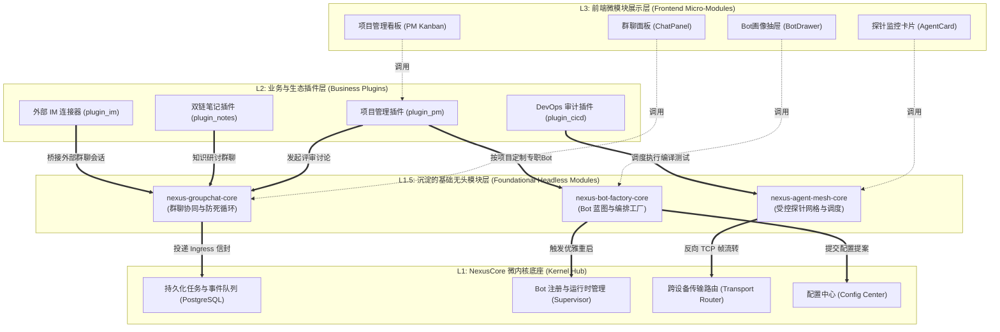

# M8 阶段详细设计定版：核心能力基础模块化沉淀与接口契约规范

> **阶段代号**：M8（Foundational Headless Modules & Core Capabilities Submersion）  
> **文档状态**：正式定版归档（Approved & Finalized，含接口注册与依赖治理）  
> **定版日期**：2026-11-15  
> **核心战略**：将 Bot 群聊（GroupChat）、Agent 探针调度（Agent Mesh）、Bot 编排创建（Bot Factory）从垂直页面耦合的业务插件中剥离，沉淀为**彻底无头化（Headless）、不负责 UI、仅提供标准化接口**的基础能力模块，并由配置中心进行接口注册、DAG 拓扑加载与依赖生命周期治理，供上层所有业务插件（项目管理、协同编写、DevOps 审计、外部 IM 等）及前端微视图自由调用。配套治理详设见 [doc/M8-Update-插件接口注册与依赖治理方案.md](file:///home/yhy/Projects/NexusCore/doc/M8-Update-插件接口注册与依赖治理方案.md)。

---

## 1. 为什么需要 M8 沉淀？

在 M3~M7 阶段，NexusCore 快速构建了“单体记忆 + 多 Bot 群聊 + 本地 Agent 探测 + Bot 画像定制 + 前端工作台”的核心实机闭环。  
然而，在这一阶段的演进中，三大核心能力存在不同程度的“垂直插件局部耦合”或“前端视图绑死”现象：
1. **群聊（GroupChat）**：原本作为独立全栈插件（`GroupChatPlugin`）实现，其房间模型与上下文分发逻辑容易被视作仅服务于主界面的 Chat 聊天视区；当其他业务插件（如需求讨论、PR Review、代码调试会话）需要发起多 Bot 协同讨论时，难以以轻量方式直接复用。
2. **Agent 探针（Agent Probe & Mesh）**：原本主要作为受控物理执行的底层驱动，调度逻辑散落在 `agent-daemon` 与 Bot 简单 Agent 的 hardcode 协议映射中，缺少面向多插件并发调用、跨设备网格治理、动态能力注册（Capabilities）与噪音蒸馏（Anti-Noise Distillation）的通用服务接口。
3. **Bot 创建（Bot Creator / Factory）**：原本在 M6 中设计为带前端向导的独立插件，其蓝图校验、单体记忆初始化（≤200行约束）、全局 API Key 装配以及与微内核配置中心（ConfigCenter）/ Supervisor 重启策略的交互逻辑，未能对其他插件开放。

**M8 的核心宗旨是“能力下沉，无头开放”**：
- **剥离一切 UI 逻辑**：基础模块内严禁出现任何 HTML、Vue 模板、CSS 样式或前端专用渲染代码。
- **纯粹契约驱动**：三大模块以标准 Headless 服务与 Go/TS SDK 形式暴露接口（gRPC / REST / 内部信封 RPC）。
- **赋能上层业务插件**：任何第三方业务插件（如双链笔记插件、项目管理插件、CI/CD 插件）均可通过标准接口，零门槛集成“多 Bot 群聊讨论”、“物理探针命令执行”、“动态按需定制专职 Bot”。
- **UI 彻底微模块化**：前端展示完全交由 M7 的前端插件注册表（`PluginRegistry`）中的纯视图组件按需接入渲染。

---

## 2. 总体架构与四层分层模型

沉淀后，NexusCore 系统的运行拓扑收敛为严谨的四层架构，如图所示：



---

## 3. 三大基础模块详细沉淀设计与接口契约

### 3.1 基础模块一：`nexus-groupchat-core`（多 Bot 群聊基础模块）

#### 3.1.1 定位与职责
`nexus-groupchat-core` 是纯无头的**群聊协同引擎与消息会话路由器**，不负责任何 UI 气泡、输入框或页面渲染。
- **职责范围**：
  1. 维护虚拟房间（Room）与会话上下文时序，支持多 Bot 与人类用户同台；
  2. 实施群聊上下文滑动窗口管理与持久化存储；
  3. **严格执行“仅用户 @ 触发”的路由安全铁律**：精确解析输入文本中的 `@<bot_id>`；对用户发送的 @ 转化为目标 Bot 的执行任务；对 Bot 回复中的 @ 标签强制降级为纯文本，彻底切断 Bot 间自发级联互唤，杜绝死循环；
  4. 自动构造符合因果链标准的信封（`Envelope`），通过 Ingress 将任务安全投递至内核持久队列。

#### 3.1.2 核心接口契约规范 (API Specification)

```go
package groupchat

import "context"

// Room 定义无头群聊房间元数据
type Room struct {
    RoomID      string            `json:"room_id"`
    Topic       string            `json:"topic"`
    OwnerID     string            `json:"owner_id"`     // 创建该房间的插件或用户 Bot ID
    Members     []string          `json:"members"`      // 准入的 Bot ID 与 User ID 列表
    Metadata    map[string]string `json:"metadata"`     // 业务扩展挂载 (如 project_id, issue_id)
    CreatedAt   int64             `json:"created_at"`
}

// Message 定义会话消息实体
type Message struct {
    MessageID   string            `json:"message_id"`
    RoomID      string            `json:"room_id"`
    SenderID    string            `json:"sender_id"`
    Role        string            `json:"role"`         // "user" | "bot" | "system"
    Content     string            `json:"content"`
    Mentions    []string          `json:"mentions"`     // 提取出的目标 Bot 列表
    Timestamp   int64             `json:"timestamp"`
    Correlation string            `json:"correlation_id"`
}

// CoreService 群聊无头基础服务接口
type CoreService interface {
    // 房间生命周期管理
    CreateRoom(ctx context.Context, req CreateRoomRequest) (*Room, error)
    GetRoom(ctx context.Context, roomID string) (*Room, error)
    CloseRoom(ctx context.Context, roomID string) error

    // 消息投递与分发（核心路由逻辑）
    // 接收消息并严格实施“仅用户 @ 唤醒”原则，返回被实际触发调度入总线的 Bot 列表
    PostMessage(ctx context.Context, req PostMessageRequest) (*PostMessageResult, error)

    // 历史消息查询与上下文回溯
    GetHistory(ctx context.Context, roomID string, limit int, beforeID string) ([]*Message, error)

    // 实时消息订阅（基于 SSE 或 gRPC 流式推送给上层插件或前端桥接器）
    SubscribeEvents(ctx context.Context, roomID string) (<-chan *Message, error)
}

type CreateRoomRequest struct {
    RoomID   string            `json:"room_id"`   // 可选，未提供则系统自动生成
    Topic    string            `json:"topic"`
    OwnerID  string            `json:"owner_id"`
    Members  []string          `json:"members"`
    Metadata map[string]string `json:"metadata"`
}

type PostMessageRequest struct {
    RoomID      string `json:"room_id"`
    SenderID    string `json:"sender_id"`
    Role        string `json:"role"`             // "user" | "bot"
    Content     string `json:"content"`
    ClientToken string `json:"client_token"`     // 幂等键
}

type PostMessageResult struct {
    Message       *Message `json:"message"`
    TriggeredBots []string `json:"triggered_bots"` // 实际触发总线调度的 Bot 列表 (若 Role=="bot"，此切片恒为空)
    IdempotentHit bool     `json:"idempotent_hit"`
}
```

---

### 3.2 基础模块二：`nexus-agent-mesh-core`（受控探针网格与调度基础模块）

#### 3.2.1 定位与职责
`nexus-agent-mesh-core` 是微内核 Transport 路由上层的**物理探针抽象与受控执行服务**，是“脑手分离”铁律的核心支撑。
- **职责范围**：
  1. 维护跨设备 `agent-daemon` 反向连接池与探针健康状态机（心跳 15s 探活与失联回收）；
  2. 集中管理探针能力清单（Capabilities），包括本地 CLI 适配器（Claude Code / Codex / Aider）与内建受控工具（Bash 白名单工具、文件读写、环境检测）；
  3. 提供多路复用会话调度（Stream ID Mux），实现命令下发、安全租约校验、流式帧追踪；
  4. **两阶段噪音拦截与结果蒸馏引擎（Distillation Engine）**：对探针上报的海量原始标准输出（Raw Stream）实施清洗过滤，提炼结构化摘要（Distilled Artifact），保护 Bot 上下文不被撑爆。

#### 3.2.2 核心接口契约规范 (API Specification)

```go
package agentmesh

import "context"

// ProbeStatus 探针健康与连接状态
type ProbeStatus string
const (
    ProbeStatusOnline  ProbeStatus = "online"
    ProbeStatusBusy    ProbeStatus = "busy"
    ProbeStatusOffline ProbeStatus = "offline"
)

// ProbeInfo 探针资产描述
type ProbeInfo struct {
    AgentID      string            `json:"agent_id"`
    DeviceName   string            `json:"device_name"`
    RemoteAddr   string            `json:"remote_addr"`
    Capabilities []string          `json:"capabilities"` // 如 ["nexus.echo.v1", "nexus.cli.claude", "nexus.bash.v1"]
    Status       ProbeStatus       `json:"status"`
    LastHeartbeat int64            `json:"last_heartbeat"`
}

// ExecutionRequest 物理探针受控调用请求
type ExecutionRequest struct {
    AgentID     string            `json:"agent_id"`
    ProtocolID  string            `json:"protocol_id"`  // 对应插件协议，如 "nexus.cli.codex"
    Payload     []byte            `json:"payload"`      // 协议特定载荷
    TimeoutSec  int               `json:"timeout_sec"`  // 执行超时硬封顶 (默认 ≤ 30s)
    DistillRule string            `json:"distill_rule"` // 蒸馏规则标识 (如 "compiler_error_only", "json_extract")
}

// ExecutionResult 执行结果（含蒸馏后的精炼产物）
type ExecutionResult struct {
    ExitCode        int    `json:"exit_code"`
    DistilledOutput string `json:"distilled_output"` // 精炼后的摘要文本，专供 Bot 决策
    RawStreamRef    string `json:"raw_stream_ref"`   // 完整日志存储索引 (不进 Bot 上下文，供人工回溯)
    DurationMs      int64  `json:"duration_ms"`
}

// CoreService 探针网格无头基础服务接口
type CoreService interface {
    // 探针资产与拓扑查询
    ListProbes(ctx context.Context, filter ProbeFilter) ([]*ProbeInfo, error)
    GetProbe(ctx context.Context, agentID string) (*ProbeInfo, error)

    // 受控同步调度执行 (由 Bot 运行时或业务插件调用)
    Execute(ctx context.Context, req ExecutionRequest) (*ExecutionResult, error)

    // 受控流式调度 (支持实时捕获终端帧与中间进度)
    ExecuteStream(ctx context.Context, req ExecutionRequest) (<-chan StreamFrame, error)

    // CLI 驱动动态登记 (与 M5 本地 Agent 探测结果联动)
    RegisterCLIDriver(ctx context.Context, agentID string, driverManifest CLIDriverManifest) error
}

type StreamFrame struct {
    StreamID uint32 `json:"stream_id"`
    FrameType string `json:"frame_type"` // "stdout" | "stderr" | "status" | "error"
    Data      []byte `json:"data"`
}

type CLIDriverManifest struct {
    DriverName string   `json:"driver_name"`
    BinPath    string   `json:"bin_path"`
    Args       []string `json:"args"`
    MaxTimeout int      `json:"max_timeout"`
}
```

---

### 3.3 基础模块三：`nexus-bot-factory-core`（Bot 蓝图与编排工厂基础模块）

#### 3.3.1 定位与职责
`nexus-bot-factory-core` 是纯后端的 **Bot 实例定义、校验、配置编排与生命周期协同服务**。
- **职责范围**：
  1. **Bot 蓝图合法性校验**：命名规则校验（`^[a-z0-9_]{5,64}$`）、系统保留名黑名单校验（严禁使用 `user_bot / create_bot / monitor_bot / security_bot`）；
  2. **四层单体记忆初始模板校验**：严格实施 Claude Code 单体记忆规范，初始化 `MEMORY.md` 模板必须满足 **≤ 200 行硬约束**，超限立即抛出校验异常；
  3. **凭据与 Agent 权限装配**：自动注入全局单 API Key（`global.llm` 凭证），装配允许调用的探针白名单（`allowed_agents`）；
  4. **内核配置中心提案编排**：将 Bot 蓝图编译为标准的 `kernel_config_proposals`（域类型 `scope_type=bot`），计算 Spec Checksum；
  5. **协同 Supervisor 毫秒级重启**：在提案被 `user_bot` 批准后，驱动 Supervisor 执行 Bot 实例的启动或优雅热重载。

#### 3.3.2 核心接口契约规范 (API Specification)

```go
package botfactory

import "context"

// BotBlueprint Bot 蓝图配置结构
type BotBlueprint struct {
    BotID         string            `json:"bot_id"`
    DisplayName   string            `json:"display_name"`
    Role          string            `json:"role"`            // 角色定位 (如 "architect", "reviewer", "ops")
    SystemPrompt  string            `json:"system_prompt"`   // 核心系统指令
    Persona       string            `json:"persona"`         // 性格与语气特征
    InitialMemory string            `json:"initial_memory"`  // 初始 MEMORY.md 内容 (严格限制 ≤ 200 行)
    AllowedAgents []string          `json:"allowed_agents"`  // 允许调用的物理探针白名单
    Metadata      map[string]string `json:"metadata"`        // 归属插件、项目标签等
}

// ValidationResult 蓝图静态合规检查结果
type ValidationResult struct {
    Valid       bool     `json:"valid"`
    MemoryLines int      `json:"memory_lines"` // 行数统计
    Violations  []string `json:"violations"`   // 违规明细列表
}

// CoreService Bot 工厂无头基础服务接口
type CoreService interface {
    // 静态语法与安全边界校验 (无副作用)
    ValidateBlueprint(ctx context.Context, bp BotBlueprint) (*ValidationResult, error)

    // 创建 Bot 提案并提交至内核配置中心
    ProposeCreateBot(ctx context.Context, bp BotBlueprint, proposerBotID string) (proposalID string, err error)

    // 修改已存在 Bot 的画像与单体记忆 (生成修改提案)
    ProposeUpdateBot(ctx context.Context, botID string, updates BotBlueprint, proposerBotID string) (proposalID string, err error)

    // 触发实例优雅重启 (需权限校验，联动 Supervisor)
    RestartInstance(ctx context.Context, botID string) error

    // 获取当前系统中所有活跃 Bot 的蓝图视图
    GetBlueprint(ctx context.Context, botID string) (*BotBlueprint, error)
}
```

---

## 4. 业务插件调用模式与实战场景

得益于 M8 的沉淀，任何业务插件均可作为消费方，无需绑定前端，直接调用基础模块。

### 场景 A：敏捷项目管理插件（`plugin_pm`）在缺陷卡片中发起协同群聊
```go
// 业务插件只需依赖 groupchat 基础核心，便能在缺陷卡片中拉起群聊研讨
func OnBugReportCreated(ctx context.Context, gc groupchat.CoreService, bug Issue) error {
    room, err := gc.CreateRoom(ctx, groupchat.CreateRoomRequest{
        Topic:   "缺陷排查: " + bug.Title,
        OwnerID: "plugin_pm",
        Members: []string{"user_qa_bot", "user_backend_bot"},
        Metadata: map[string]string{"issue_id": bug.ID},
    })
    if err != nil {
        return err
    }
    // 投递初始上下文，自动触发 @user_qa_bot 协助分析
    _, err = gc.PostMessage(ctx, groupchat.PostMessageRequest{
        RoomID:   room.RoomID,
        SenderID: "plugin_pm",
        Role:     "user", // 模拟用户身份唤醒
        Content:  fmt.Sprintf("@user_qa_bot 请结合复现步骤分析此缺陷: %s", bug.Description),
    })
    return err
}
```

### 场景 B：持续集成与审查插件（`plugin_cicd`）调度本地探针执行构建并蒸馏
```go
// 业务插件直接利用 agentmesh 基础服务调度探针执行命令，享受脑手分离与噪音蒸馏
func RunBuildVerification(ctx context.Context, mesh agentmesh.CoreService, codeRepo string) (*BuildSummary, error) {
    res, err := mesh.Execute(ctx, agentmesh.ExecutionRequest{
        AgentID:     "local_agent_probe",
        ProtocolID:  "nexus.cli.bash",
        Payload:     []byte(fmt.Sprintf(`{"cmd":"cd %s && make build"}`, codeRepo)),
        TimeoutSec:  60,
        DistillRule: "compiler_error_only", // 只要编译错误，丢弃数万行标准构建日志
    })
    if err != nil {
        return nil, err
    }
    return &BuildSummary{
        Success: res.ExitCode == 0,
        Summary: res.DistilledOutput, // 干净紧凑的结论，可直接送入 Bot 或通知系统
    }, nil
}
```

### 场景 C：工程工作空间初始化器（`plugin_workspace_init`）按需派生专用审查 Bot
```go
// 业务插件自动化定制具有特定画像与 Agent 绑定关系的专职 Bot
func SetupProjectBot(ctx context.Context, factory botfactory.CoreService, prjName string) error {
    bp := botfactory.BotBlueprint{
        BotID:        "user_" + prjName + "_reviewer",
        DisplayName:  prjName + " 代码审查助手",
        Role:         "reviewer",
        SystemPrompt: "你专注于严格审查该工程的代码风格、并发安全与测试覆盖率。",
        Persona:      "客观、严谨、直接指出潜在风险。",
        InitialMemory: "# 专职记忆\n- 重点关注锁竞争与 Goroutine 泄漏\n- 覆盖率硬门槛 80%\n",
        AllowedAgents: []string{"local_agent_probe"},
    }
    // 提交创建提案，等待 user_bot 在终端审批
    proposalID, err := factory.ProposeCreateBot(ctx, bp, "plugin_workspace_init")
    log.Printf("Bot 创建提案已提交: %s，等待 user_bot 审批生效", proposalID)
    return err
}
```

---

## 5. 全面架构与安全合规审计报告 (Audit Report)

为确保 M8 沉淀方案严格遵循 NexusCore 顶层设计哲学，不破坏系统演进边界，对照 `AGENTS.md` 架构硬约束、安全边界与开发规范进行了逐条细致审计。

### 5.1 架构硬约束逐条审计矩阵

| 序号 | 架构硬约束条目 (摘自 AGENTS.md) | M8 设计遵从性实现与防护机制 | 审计结论 |
| :---: | :--- | :--- | :---: |
| **1** | **只有 Bot 能投递与消费消息**。用户以 `user_bot` 入总线，插件经注册 bot 委托入总线。 | `nexus-groupchat-core` 投递消息入 Hub Ingress 时，强制将消息封装为所属 `groupchat_bot` 或对应触发身份的合法 Ingress 信封，不破坏总线主体单一性。 | **合规 (PASS)** |
| **2** | **信封只承载通讯语义**（身份、因果链、幂等）。 | 消息投递时，信封仅承载 `from_bot_id`、`channel`、`correlation_id`、`causation_id`、`idempotency_key`。房间元数据、对话业务载荷放入 Payload 或业务层维护，不在信封中扩充非标准业务字段。 | **合规 (PASS)** |
| **3** | **信封不含业务维度**（`project_id / conversation_id` 等不进信封）。 | 房间所属的 `project_id`、`issue_id` 统一收敛在 `Room.Metadata` 中，并在 `ContextEnvelope` 业务载荷中以 `payload_ref` 传递，绝不污染外层信封。 | **合规 (PASS)** |
| **4** | **内核不做上下文水合推送**。 | 接收方 Bot 被唤醒后，仅收到信封触发通知，随后通过 GroupChat 或自身工具接口自主拉取会话切片，保持内核推送的极简性与按需水合原则。 | **合规 (PASS)** |
| **5** | **hub 收敛为三类原语**（持久队列、Bot 运行时与配置、传输路由）。业务语义绝不出现在 hub 源码里。 | **关键防线**：三大基础模块沉淀在 `internal/modules/` 或独立基础库中，**绝不侵入 `hub/` 内核源码**。Hub 依然只运行 10 大核心模块，保持微内核绝对纯净。 | **合规 (PASS)** |
| **6** | **记忆只属于 `plugin_memory`**，内核不定义任何记忆结构与图谱。 | Bot 工厂仅负责初始化单体记忆静态模板文件（≤200行约束的 `MEMORY.md`）；全局知识图谱、四象限晋升依然严格归属于记忆插件，工厂不涉及任何图谱表操作。 | **合规 (PASS)** |
| **7** | **内核不做上下文装配与记忆仲裁**。 | 基础模块严格遵循此项。群聊历史仅为滑动窗口文本缓存；记忆整合由原有的 Auto Dream 离线流转负责，不新增内核装配逻辑。 | **合规 (PASS)** |
| **8** | **内核不为特定插件保留特殊通道**。 | 所有基础模块与上层插件的交互，均通过标准 gRPC / Ingress 信封 / REST 契约进行，与系统其他插件完全同级。 | **合规 (PASS)** |
| **9** | **Bot 是独立二进制进程**，Supervisor 是唯一执行器；两级进程模型隔离。 | Bot 工厂创建的 Bot 仍然是运行在 `bot-runtime` 的受限进程，启动与重启完全委托给微内核 Supervisor，模块自身绝不私自 `exec` Bot 进程。 | **合规 (PASS)** |
| **10** | **保留名禁用**（`user_bot / create_bot / monitor_bot / security_bot`）。 | `nexus-bot-factory-core` 在 `ValidateBlueprint` 阶段即注入保留名硬拦截器，任何试图创建/修改保留名的请求均被直接阻断（Fail-Fast）。 | **合规 (PASS)** |
| **11** | **长连接经 Agent Mesh 路由，不绕过 ACL**。 | `nexus-agent-mesh-core` 的调用全量经过微内核 Transport 路由鉴权层，严格校验 Bot 的 `allowed_agents` 白名单，严禁越权建立直连。 | **合规 (PASS)** |
| **12** | **所有消息必须携带完整因果链**。 | GroupChat 在生成 Ingress 请求时，严格继承客户端传入的 `CorrelationID`，生成唯一的 `idempotency_key`，缺失链路信息的请求直接拒绝。 | **合规 (PASS)** |
| **13-16** | **知识存储边界与 Schema 隔离**。 | 基础模块均不创建或修改 `memory` / `vault` schema，仅依赖现有的内核或独立模块表，不越权访问知识存储。 | **合规 (PASS)** |
| **17** | **内核不解析插件 payload**。 | `nexus-agent-mesh-core` 的传输帧在内核 Transport 层只做 length / protocol_id / stream_id 路由转发，载荷解析与结果蒸馏完全在基础模块与插件端闭环。 | **合规 (PASS)** |

---

### 5.2 核心安全防线与反腐化专项审计

#### 5.2.1 脑手分离与 Shell 隔离防线
- **风险点**：基础模块是否会让 Bot 获得本地 Shell 执行特权？
- **审计验证**：
  - Bot 运行时代码库（`bot-runtime/`）依然保持“禁 Shell、禁长思考”规则；
  - `nexus-agent-mesh-core` 仅为反向 TCP 探针的调度中继器。所有实际物理命令只能下发给受控的 `agent-daemon`，并受限于探针侧的 Bash 白名单与超时保护；
  - **结论**：脑手分离边界坚若磐石。

#### 5.2.2 群聊防死循环与 Token 防膨胀机制
- **风险点**：业务插件自主调用群聊模块，是否可能诱发 Bot 间循环互 @ 唤醒，导致死循环与 Token 爆炸？
- **审计验证**：
  - 在 `nexus-groupchat-core` 内部状态机中，将“防死循环机制”固化为不可绕过的底层规则：
    ```text
    if sender.Role != "user" {
        triggeredBots = nil // 无论 Bot 回复中包含多少个 @xxx_bot，触发列表强制置空
    }
    ```
  - 任何上层插件通过接口投递 Bot 消息时，该模块均不会产生下行 Ingress 任务。
  - **结论**：彻底根除死循环隐患，即便上层业务插件逻辑失误，也无法击穿该防线。

#### 5.2.3 配置安全与防私自篡改
- **风险点**：Bot 工厂模块是否会绕过配置中心直接写库或自批生效？
- **审计验证**：
  - `nexus-bot-factory-core` **无权直接更新 `kernel_config_active` 或直接写库**；
  - 工厂仅生成标准的 `kernel_config_proposals` 提案记录（附带 SHA-256 Checksum）；
  - 激活仍须严格由 `user_bot` 在真实交互终端完成批准（Approve）；
  - **结论**：完全契合微内核配置中心四阶段安全审批流（Proposal -> Security -> User -> Active）。

#### 5.2.4 零 UI 侵入性保障
- **风险点**：沉淀的基础模块是否残留了 Vue 视图逻辑，影响纯后端编译或微前端解耦？
- **审计验证**：
  - 基础模块代码纯度 100%（纯 Go 语言结构体与接口，依赖仅限于标准库与项目内部协议包）；
  - 前端各卡片（ChatBubble、MentionInput、AgentActivityCard、BotDrawer）完全保留在 `Frontend/` 或作为独立微前端模块接入；
  - **结论**：Headless 架构边界清晰，不含任何 UI 耦合代码。

---

## 6. M8 落地实施计划与验收标准

### 6.1 实施路径与工期评估（8-10 人日）
1. **第 1-3 天：核心服务抽象与接口定义**
   - 提取 `GroupChatPlugin` 的核心状态机为 `internal/modules/groupchat` 无头服务；
   - 梳理 Agent Mesh 调度驱动与蒸馏过滤器为 `internal/modules/agentmesh`；
   - 抽象 Bot 工厂提案编排器为 `internal/modules/botfactory`；
   - 编写统一的契约测试套件（Contract Tests）。
2. **第 4-6 天：上层适配与纯无头化改造**
   - 改造现有 `GroupChatPlugin`，使其瘦身为消费 `groupchat-core` 的轻量封装；
   - 改造现有前端调用链路，前端通过统一的 REST/SSE 网关接口与基础模块通信；
   - 编写多插件并发调用 Mock 示例，验证无 UI 场景下的复用性。
3. **第 7-8 天：全链路冒烟与自动化回归**
   - 编写 `make smoke-m8` 自动化冒烟脚本：
     - 测试业务插件无 UI 纯后台拉起群聊与防死循环验证；
     - 测试并发调度探针并完成 3 行编译错误蒸馏；
     - 测试自动生成 Bot 提案、终端审批、200 行记忆校验与 Supervisor 重启生效；
   - 确认既有 `make test`、`make smoke-m1`~`make smoke-m4` 持续全绿。

### 6.2 验收标准
- [ ] 三大基础模块完全独立于任何 UI 库，无前端依赖，单测覆盖率 ≥ 85%；
- [ ] 外部业务插件可在不启动任何前端页面的前提下，通过 Go SDK / REST 接口无缝拉起多 Bot 群聊研讨并获取会话上下文；
- [ ] Agent 探针调度具备两阶段结果蒸馏能力，海量日志自动精炼，Bot 上下文防撑爆；
- [ ] Bot 工厂严格实施保留名黑名单拦截与 `MEMORY.md` ≤ 200 行校验，严格走配置中心提案审批链路；
- [ ] 全套自动化验证 `make smoke-m8` 一键执行通过，全链路因果链留痕完整。
