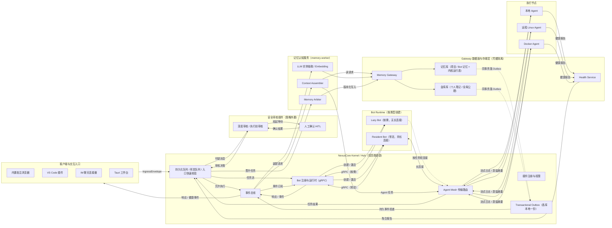

# NexusCore 架构设计总结

> 整理时间：2026-11-05  
> 来源：`doc/` 下三份架构讨论笔记，以及后续关于队列调度与多 Bot 记忆一致性的补充讨论  
> 状态：设计文档，尚未对应到已实现代码

## 1. 一句话定位

NexusCore 是一个以微内核为基础的个人智能工作台：内核只负责知识访问与图谱存储、持久化事件与任务队列、Bot 注册和跨设备路由；所有具体业务功能都以插件形式接入。系统同时遵守“脑手分离”原则，Bot 作为长期记忆与决策大脑运行在内核侧，Agent 作为无人格执行探针运行在本地或远程设备上。项目公共记忆是多个 Bot 的共享协作锚点，Bot 工作区只保存私有草稿，跨 Bot 可见的信息必须经过队列化晋升和一致性仲裁。认知处理（上下文装配、记忆仲裁）与深度审核策略运行在内核之外的 memory-worker 与安全插件中，内核不包含这些业务语义。个人笔记与全局公理存放在独立金库库，所有 Bot 只能经 Memory Gateway 只读访问；项目记忆与 Bot 记忆由记忆服务统一持有，业务插件只保存 `entity_id` 引用（见 8.4）。

## 2. 设计演进脉络

三份笔记代表了架构从功能罗列到边界收敛的三个阶段：

| 阶段 | 时间 | 核心命题 | 主要结论 |
| --- | --- | --- | --- |
| 初版全景方案 | 11.03 10:47 | 搭建跨设备记忆与工作台 | 确立 Go Hub、Python 记忆引擎、Tauri 工作台、VS Code 插件组合；提出 `ContextEnvelope` 与记忆图谱 |
| 微内核插件化方案 | 11.03 10:52 | 防止功能膨胀成巨石单体 | 提出内核只保留四大原语；业务全部插件化；用 `kernel_entities/kernel_relations` 统一笔记、记忆和任务 |
| 脑手分离方案 | 11.03 11:27 | 划清 Bot 与 Agent、Bot 记忆与项目记忆边界 | 提出 Bot/Agent 双工任务流、输出蒸馏、正交记忆矩阵和记忆晋升机制 |

最终采用第三阶段的边界规则，并保留前两阶段的模块划分与技术选型。

## 3. 核心架构原则

### 3.1 微内核

内核不理解任何具体业务，不包含笔记渲染、看板拖拽、IM SDK、浏览器实现或具体工具执行逻辑。它只提供四类底层原语：

1. **知识访问与图谱存储**：图谱只承载知识域；物理上分为金库库（个人笔记、全局公理）与记忆库（项目记忆、Bot 记忆、网页摘录），两库统一经 Memory Gateway 访问。PM 任务等强结构业务数据不入图谱，由插件自己的类型化表存储并通过 `entity_id` 引用图谱节点（见 8.1 / 8.4）。
2. **事件、消息与持久化任务队列**：插件之间通过事件解耦。事件分为两类：正确性相关的持久事件（如 `project.memory.updated`、`task.state.changed`）必须与状态变更同事务写入 Transactional Outbox，再经持久化 Job Table 按 Consumer Group 投递，支持重投与显式 ack；UI 刷新类尽力而为事件可走内存通道，丢失可容忍（见 6.7）。入站消息、Bot 任务、审核任务和 Agent 任务进入持久化队列，支持重试、租约、死信和顺序分区。所有进入内核的消息必须携带完整因果链并通过统一入口校验（见 6.10）。
3. **Bot 注册与运行时**：维护 Bot 身份、System Prompt、模型绑定、记忆空间和插件权限；内核是 Bot 独立二进制的唯一创建者与监督者，按 `activation_mode`（lazy / resident）激活、健康检查、崩溃重启与回收；lazy Bot 不持有 Bot-Agent 长连接，resident Bot 持有长连接；Bot 通过 gRPC 控制面注册、心跳、拉取任务与订阅事件（见 5.4 / 5.5）。
4. **跨设备传输路由**：维护 Agent 节点连接池与原生 TCP/UDP 会话，把工具调用路由到对应设备；内核只负责传输、鉴权、多路复用与背压，应用层协议由插件定义（见 5.1）。

以下强业务语义组件不属于内核，必须外置：

- Context Assembler（上下文装配）与 Memory Arbiter（记忆仲裁）：归入 memory-worker 认知服务。
- 深度审核与执行前审核策略：归入安全审核插件。
- Memory Gateway 与金库库：Memory Gateway 是独立数据面，金库凭据只存在于网关；内核其余部分不直连金库。
- Gateway Health Service：负责 Agent/Bot 健康报告的聚合、去重与评分；内核只做注册、策略校验与事件广播。
- 内核对它们只提供经 Memory Gateway 的图谱读写、版本化写入、晋升队列入队和审计事件投递等原语。

判断一个功能是否属于内核的标准：如果把 Obsidian、PM、IM、浏览器、VS Code 全部删除，再把 Context Assembler、Memory Arbiter 和审核策略也删除，剩下的部分是否仍能作为存储与调度底座独立运行并保持核心价值。

### 3.2 万物皆插件

插件分为三类：

| 插件类型 | 代表模块 | 职责 |
| --- | --- | --- |
| 入站通道插件 | QQ、Telegram、Discord、飞书、VS Code 插件、批注浏览器 | 作为所服务 bot（含 user_bot）的投递代理：外部交互转成业务载荷（`ContextEnvelope`），以该 bot 的 `IngressEnvelope` 投递进内核；系统响应渲染回原渠道 |
| 工作台视图插件 | Obsidian 双链笔记、PM 看板、记忆图谱、Bot 管理后台 | 知识视图经 Memory Gateway 读写图谱；PM 等强结构插件读写自己的类型化表，通过 `entity_id` 引用图谱节点 |
| 执行器插件 | 远程 Agent、本地沙盒、数据库查询工具 | 按插件协议监听工具调用，在具体环境中执行并返回结果 |

插件通过 Manifest 声明插件 ID、类型、期望订阅的事件、提供工具、UI 挂载点与传输/协议能力；注册需要身份凭证，订阅与工具权限由用户逐项批准后生效（见 3.4）。

### 3.3 脑手分离

这是系统最重要的运行边界。

| 对象 | 位置 | 是否有长期人格 | 是否有记忆 | 是否执行物理操作 |
| --- | --- | --- | --- | --- |
| 用户 | user_bot，常驻席位 | 用户本人 | 全量访问（经网关 ACL） | 经客户端插件投递 / 消费消息 |
| Bot | 内核侧，独立二进制进程，按 lazy / resident 类型激活 | 有 | 有，分角色记忆和项目记忆 | 不直接执行文件或 Shell 操作 |
| Agent Tool | 本地电脑、服务器、Docker、浏览器执行环境 | 无 | 只有任务工作现场 | 提供算力和工具，执行 `bash_exec`、`git_diff` 等 |

统一总线规则：用户以 `user_bot` 身份在总线上（客户端插件只是 user_bot 的投递 / 展示代理）；**只有 bot 能投递与消费消息**，内核是各个 bot 之间的消息通道（每 bot 一个 Consumer Group 即其邮箱）。入口适配器（IM / VS Code / 浏览器 / CLI）代 bot 发信，不允许非 bot 主体直入内核。

该边界的价值：

1. 防止 Agent 的大体积输出直接污染 Bot 上下文和记忆库。
2. 防止 Bot 携带项目私有知识跨项目迁移造成记忆串台。
3. 允许更换 Bot 时继承项目资产，也允许同一 Bot 服务多个项目。

### 3.4 插件与 Agent 信任边界

Manifest 只是声明，不构成授权；授权由用户在工作台逐项完成，内核强制执行。

插件身份与订阅授权：

1. 插件安装时由用户签发身份凭证（短期 token，可轮换、可吊销），凭证绑定 `plugin_id`；进程接入内核必须携带凭证，未认证进程无法以插件身份注册或订阅事件。
2. Manifest 声明的是“期望权限”（订阅事件、提供工具、UI 挂载点、namespace 访问、传输与协议声明）；用户批准后写入注册表，未批准的声明一律不生效。
3. 事件订阅授权按 `namespace / project / bot` 三个维度过滤，例如“订阅 `note.updated`，仅限 `proj_nexus` 的 `obsidian_note`”。

事件载荷 ACL：

- Dispatcher 在投递前按订阅方权限过滤载荷：无权字段剔除或脱敏，禁止先广播全量再靠接收方自觉。
- 载荷过滤失败按投递失败处理并重试，绝不降级为全量投递。
- 用户可随时吊销订阅，吊销后该 Consumer Group 不再收到新事件。

Agent 凭证与高危权威：

1. Agent 放弃静态 `auth_token`，改用可轮换凭证（短期 token 或 mTLS）；注册即绑定设备身份、能力清单与允许的 project 范围。
2. 高危命令的权威归属：Agent 侧安全护栏是最终权威，hub 执行前审核是策略层；高危操作必须两端都放行，任一端拒绝即拒绝并进入安全审计。

## 4. 系统总体结构



建议的 monorepo 结构：

```text
nexus-core/
├── hub/                 # Go 微内核网关：连接、鉴权、路由、事件总线、队列、事务；MVP 内含 Gateway 模块（Memory Gateway + Health Service，不含认知与审核策略）
├── bot-runtime/         # Bot 独立二进制运行时：由内核按需创建与回收，通过 gRPC 接入
├── memory-worker/       # Python 记忆认知引擎：上下文装配、记忆仲裁、抽取、嵌入、蒸馏、晋升；持有记忆库
├── agent-daemon/        # 跨设备探针：原生 TCP/UDP 会话、本地工具执行；应用层协议由插件定义
├── workbench-app/       # Tauri + React 工作台
└── vscode-ext/          # VS Code 原生插件
```

## 5. Bot 与 Agent 通信协议

内核只提供传输层，应用层协议由插件定义。Bot 与 Agent 之间不再绑定 JSON-RPC 或 WebSocket；JSON-RPC over WebSocket 可以作为某个 Agent 插件的应用层实现，但不再是内核契约。

### 5.1 传输层与应用层边界

| 层 | 归属 | 职责 |
| --- | --- | --- |
| 传输层 | 内核 | TCP/UDP 会话、反向连接、鉴权、多路复用、心跳、背压、重连、限流 |
| 应用层 | 插件 | 帧格式、序列化、RPC 语义、流式语义、错误码、任务状态机、幂等 |

内核只定义最小传输信封，用于在同一连接上复用多个插件的逻辑流；信封之后的字节由插件协议解释：

```text
transport_frame
├── protocol_id      # 插件协议标识
├── protocol_version
├── stream_id        # 同一连接内的逻辑流
├── frame_type       # data / ack / heartbeat / close（仅传输语义）
├── length           # 受 max_frame_size 限制
└── payload          # 插件自定义，内核不解析
```

约束：

1. 内核校验 `length` 上限、`protocol_id` 是否已授权、`stream_id` 是否已建立；不解析 `payload`。
2. 插件在 Manifest 注册 `transport: tcp|udp`、`protocol_id`、`version`、应用层 `framing`、`capabilities`，由用户授权后生效（见 3.4）。
3. TCP 提供有序可靠字节流；UDP 不提供可靠性、顺序与拥塞控制，使用 UDP 的插件必须自行实现重传、去重、分片或接受丢失。工具调用默认要求 TCP，UDP 只用于可丢的遥测与流式场景。
4. UDP 场景下每个数据报承载一个 `transport_frame`，超过 MTU 由插件自行分片；内核不做重组。
5. 传输层鉴权复用 3.4 的 Agent 可轮换凭证（mTLS 或短期 token）；Agent 默认反向连接 Hub 以穿透 NAT，UDP 需要打洞或中继，MVP 只要求反向 TCP。
6. 一个插件的协议错误只关闭该插件的 stream 或会话，不影响其他插件与内核。
7. 内核按 `stream_id` 绑定 job；应用层审计所需的 `correlation_id` / `causation_id` 必须由插件在 payload 中回传（见 6.8）。

### 5.2 任务四阶段

任务语义由 Agent 插件协议定义，内核只负责传输、路由与 job 状态。建议的参考流程：

1. **意图调用**
   Bot 只发出轻量指令，例如调用 `sandbox_bash` 执行测试。
2. **上下文水合**
   memory-worker 的 Context Assembler 在转发前装配项目规则、历史踩坑、环境变量等 `TaskContext`；内核只负责投递。
3. **双向交互**
   Agent 遇到高危操作、缺少参数或需要授权时，可按插件协议发起挂起请求（例如 `agent.yield_confirm`），等待 Bot 或人类确认；内核只转发 stream，不解释请求语义。
4. **结果蒸馏**
   原始输出与结构化摘要分离，只有摘要进入 Bot 上下文。

### 5.3 输出双层结构

| 输出层 | 内容 | 去向 |
| --- | --- | --- |
| `raw_stream_uri` | 完整日志、堆栈、终端输出 | 冷存储或前端终端窗口，供人工查看 |
| `distilled_artifact` | 退出码、错误文件、关键行号、核心结论、测试结果摘要 | 进入 Bot 上下文和记忆系统 |

这一步是防止上下文爆炸和记忆污染的关键，不应后置到 MVP 之后。

### 5.4 Bot↔Kernel 控制面（gRPC）

Bot 与内核之间的控制面使用 gRPC（HTTP/2 over TCP），由内核定义；它与 5.1 的 Bot↔Agent 传输层是两条独立链路：

| 链路 | 协议 | 归属 |
| --- | --- | --- |
| Bot↔Kernel | gRPC（内核控制面） | 注册、心跳、任务流、事件订阅、凭证续期由内核定义 |
| Bot↔Agent | TCP/UDP + 插件协议 | 执行语义由 Agent 插件定义 |

`BotRuntime` 服务的最小方法集：

```text
service BotRuntime {
  rpc Register(RegisterRequest) returns (RegisterResponse);
  rpc Heartbeat(HeartbeatRequest) returns (HeartbeatResponse);
  rpc StreamTasks(StreamTasksRequest) returns (stream TaskAssignment);
  rpc AckTask(AckTaskRequest) returns (AckTaskResponse);
  rpc SubscribeEvents(SubscribeRequest) returns (stream Event);
  rpc RenewCredential(RenewRequest) returns (RenewResponse);
  rpc Deregister(DeregisterRequest) returns (DeregisterResponse);
}
```

约束：

1. 传输使用 mTLS 或 metadata 中的短期 token；凭证绑定 `bot_id` / `plugin_id`，可轮换、可吊销（见 3.4）。
2. `StreamTasks` 与 `SubscribeEvents` 是服务端流；任务与事件至少一次投递，客户端用 `AckTask` 与 `request_id` 幂等确认。
3. 所有请求携带 `request_id`；任务携带 `correlation_id` / `causation_id`，断线重连后按 job 状态续传。
4. gRPC 只承载控制面；Agent 执行流仍走 5.1 的 TCP/UDP 插件协议，不把执行数据塞进控制面。
5. Bot 的业务输出仍以 `ContextEnvelope` 载荷（经 `payload_ref` 引用）或事件形式进队列，内核不解析业务载荷。
6. 健康报告不直接调用 `BotRuntime`，而是调用 Gateway 的 `HealthService`（见 6.9）；内核只接收聚合后的报告。
7. 所有 gRPC 请求必须携带 `causal_context`（见 6.8 / 6.10）；缺失或不合法的请求在入口直接拒绝并记录。
8. Lazy Bot 的 gRPC 会话随进程生命周期，不持有常驻 `StreamTasks` / `SubscribeEvents`；Resident Bot 持有长期流，断线后由内核按 `desired_state` 续订。

### 5.5 Bot 类型：lazy 与 resident

Bot 是独立二进制进程，由内核创建、监督、重启与回收。Bot 分两种激活类型，由 manifest 的 `activation_mode` 决定，内核是唯一权威；业务插件不能自行拉起 Bot。

| 维度 | Lazy Bot | Resident Bot |
| --- | --- | --- |
| 激活 | 首个任务或事件触发 | 内核启动、项目激活或用户启用 |
| 空闲 | 超过 `idle_ttl` 进入 dormant 并退出 | 不因空闲回收 |
| Bot-Agent 连接 | 不持有长连接；每个任务建立短连接，结束后关闭 | 持有长连接，按绑定的 Agent 节点复用 |
| 事件订阅 | dormant 时由内核持久化；激活后按 Consumer Group 消费 | 保持长期 `SubscribeEvents` |
| 实例 | `min_instances=0`，按队列深度扩容 | `min_instances>=1`，可配 `warm_pool` |
| 崩溃 | 退避重启，任务回队列 | supervisor 重启并重建长连接 |
| 适用 | 低频、批处理、重任务 | 交互式、低延迟、持续订阅 |

`bot_manifest` 关键字段：

```text
bot_manifest
├── bot_id
├── version
├── binary_digest
├── entrypoint
├── protocol_version
├── activation_mode      # lazy / resident
├── agent_connection     # per_task / persistent
├── resource_limits      # cpu / memory
├── start_timeout
├── min_instances
├── max_instances
├── idle_ttl             # lazy only
└── warm_pool            # resident only，默认 0
```

生命周期：

```text
lazy:     registered -> dormant -> starting -> ready -> busy -> draining -> stopped
resident: registered -> starting -> ready -> busy -> draining -> stopped
                          \-> crashed -> starting（指数退避）
```

规则：

1. 内核按 `activation_mode` 维护 `desired_state` 与 `observed_state`，通过 reconcile 循环执行 start / stop / drain / restart；调用方不能绕过类型直接拉起。
2. Lazy Bot 不持有 Bot-Agent 长连接；任务开始时建立短连接，任务结束或失败即关闭。dormant 时没有进程、没有常驻订阅，事件由内核持久化，激活后按 Consumer Group 消费。
3. Resident Bot 在 kernel 启动、项目激活或用户启用时创建，持有到其绑定 Agent 节点的长连接；长期 `StreamTasks` / `SubscribeEvents` 不因空闲断开，崩溃后由 supervisor 重启并重建连接。
4. 任务先入队再触发 lazy 激活；启动期间任务保持 queued，不提前 lease。resident 仅在未 ready 或 draining 时暂停 lease。
5. `starting` 超过 `start_timeout` 后任务回队列或进入 suspended；连续崩溃按指数退避，超过阈值熔断并上报 Health Service。
6. 长连接不绕过内核：resident 的 Bot-Agent 会话仍经 Agent Mesh 路由，受 3.4 ACL、6.8 因果链与 6.10 入口校验约束。
7. Agent 故障时，resident 的长连接会断开并重连，在途任务进入 suspended / retry；lazy 没有空闲长连接，Agent 故障由内核心跳与任务租约检测。
8. 升级采用版本固定 + drain + 切换；resident 在切换后重建长连接，lazy 无长期状态可恢复。
9. 这不改变 hub 单二进制：hub 仍是单个内核进程，lazy 按需拉起、resident 按类型常驻。

## 6. 队列与多 Bot 调度

队列与持久事件投递是内核基础设施，不是业务插件。它解决多 Bot 并发隔离、审核链路可追溯、`@bot` 失败消息不丢失、正确性事件不丢、进程崩溃后的任务恢复五类问题。

### 6.1 消息处理链路

```text
入口插件
  -> IngressEnvelope 标准化（通讯信封，6.10）；业务载荷由来源插件装入 `payload_ref`
  -> 持久化 Ingress Queue
  -> 入口快速校验（内核）与异步深度审核（安全插件）
  -> Bot 路由 / Bot Runtime Queue
  -> Agent 任务队列
  -> 响应 / 记忆晋升 / Outbox
```

所有入口先经 6.10 的 `IngressEnvelope` 校验（因果链、凭证、幂等键），再进入 Ingress Queue；校验失败的消息记录后拒绝。

每一跳继承 `correlation_id` 并设置 `causation_id`，跨队列可追溯（见 6.8）。

内核提供统一队列接口：

- `enqueue`
- `dequeue`
- `ack`
- `nack`
- `retry`
- `dead_letter`
- `replay`
- `get_job_status`
- `subscribe_events(event_types, consumer_group_id)`

### 6.2 多 Bot 并发语义

每个 Bot 是独立二进制进程，按 `activation_mode` 分为 lazy 与 resident；不同 Bot 的进程、Consumer Group、资源限制与失败域完全隔离。Lazy Bot 按需拉起且不持有 Bot-Agent 长连接，Resident Bot 常驻并持有长连接。不同 Bot 使用独立 Consumer Group，支持并行消费、独立重试、独立限流和独立失败隔离。同一条消息同时 @多个 Bot 时，消息会 fan-out 到每个 Bot 的任务副本，避免一个慢 Bot 阻塞其他 Bot。各副本在自己的 Consumer Group 内独立有序，副本之间互不有序、互不可比（见 6.6 / 6.8）。

需要区分两种协作模式：

| 模式 | 处理方式 |
| --- | --- |
| 多个 Bot 独立响应同一事件 | 队列 fan-out，每个 Bot 生成独立副本任务 |
| 多个 Bot 协作完成同一任务 | 使用任务编排器维护任务状态机，队列只负责任务分发 |

后者不能简单丢进同一个队列消费，否则会出现抢消费、结果归属不清和状态机混乱。

### 6.3 审核管道

审核采用“同步轻量审核 + 异步深度审核 + 执行前审核”三层结构：

| 审核阶段 | 检查内容 | 目标 |
| --- | --- | --- |
| 入口快速审核 | 消息格式、目标 Bot 是否存在、基础权限、项目绑定、明显危险指令 | 快速拒绝明显非法消息 |
| 异步深度审核 | 敏感信息、内容安全、Prompt 注入、上下文越权、工具调用风险 | 不阻塞普通消息，但保留全链路审计 |
| 执行前审核 | Agent 高危命令、文件修改、远程执行、跨设备访问 | 触发 HITL 或安全策略 |

审核记录建议包含：

```text
envelope_id
bot_id
project_id
audit_stage
decision      # allow / deny / retry / human_review
reason
policy_id
created_at
```

三层审核的职责归属必须区分清楚：

| 审核阶段 | 归属 |
| --- | --- |
| 入口快速审核 | 内核队列准入校验，属于协议层检查 |
| 异步深度审核 | 安全审核插件执行策略 |
| 执行前审核 | 安全审核插件执行策略，配合 Agent 侧护栏 |

具体审核策略由安全插件提供并执行；内核只持久化审核记录、审计事件和队列状态，不实现任何策略判断。

### 6.4 `@bot` 死信处理

死信消息不能只按“处理失败”粗分类，入口处应先识别原因：

| 失败类型 | 处理策略 |
| --- | --- |
| Bot 不存在 | 进入 DLQ，并通知用户 @ 的 Bot 不存在 |
| Bot 存在但无权限 | 拒绝或请求授权，保留审计记录 |
| 消息格式非法 | 保留 raw envelope，进入 DLQ，支持人工修复后 replay |
| Bot 超时或崩溃 | 指数退避重试，超过次数进入 DLQ |
| Agent 节点离线 | 任务挂起或路由到可用节点，超过 TTL 进入 DLQ |
| 高危操作被拒绝 | 进入安全审计和 HITL 历史，不算普通死信 |
| 重复消息 | 幂等去重，只记录状态，不进入 DLQ |
| 用户主动取消 | 标记 Cancelled，不算失败 |

DLQ 需要支持查看原始消息、失败原因、人工修复后重新入队、批量归档、IM 或工作台通知，以及基于 `correlation_id`（入口默认继承 `envelope_id`）的全链路追踪（见 6.8）。

### 6.5 持久化队列实现

早期不引入 Kafka、RabbitMQ 或 NATS，优先使用 MySQL Job Table 和 Transactional Outbox 实现：

```text
kernel_jobs
├── job_id
├── job_type
├── queue_name
├── envelope_id
├── bot_id
├── project_id
├── partition_key
├── correlation_id   # 业务根因，全链路不变（见 6.8）
├── causation_id     # 直接原因，指向父 job / 事件
├── status
├── attempt_count
├── next_retry_at
├── lease_owner
├── lease_until
├── priority
├── payload_json
├── result_json
└── created_at / updated_at
```

配合 `SELECT ... FOR UPDATE SKIP LOCKED` 实现多 worker 抢任务；分区内有序要求调度器不越过同分区未完成的前序任务，`SKIP LOCKED` 仅用于跨分区抢占（见 6.6）。后续规模扩大后，将队列后端抽象为接口，再切换到 NATS JetStream、Redpanda 或 RabbitMQ。

持久事件投递复用本表：`job_type = event.deliver`，`queue_name = consumer_group_id`，`payload_json` 携带 `event_id` 与事件摘要。出箱与订阅表见 6.7。

### 6.6 顺序与分区：最小可序

不做全局 FIFO，否则系统会退化成单线程。顺序承诺的精确范围只有一个：

> 同一 `partition_key` + 同一 `queue_name`（Consumer Group）内，按入队顺序投递。

由此推论：

1. 同一 `conversation_id` 且同一 Bot 的消费组内有序。
2. 同一 `project_id` 的强相关任务可在同组内串行。
3. 不同 partition_key、不同 Consumer Group、不同队列之间并行，无顺序承诺。
4. Agent 长任务独立异步，不阻塞普通聊天。
5. 跨队列接力（Ingress → Bot Runtime → Agent → 晋升）不承诺顺序，只承诺因果可追溯（见 6.8）。

分区键：

```text
partition_key = conversation_id 或 project_id
```

实现与边界：

- 分区内有序要求调度器不越过同分区未完成的前序任务；`SKIP LOCKED` 只允许跨分区抢占。
- 任务失败重试时分两种模式：严格模式（前序进入终态前不投递后续，保序但可能队头阻塞）与宽松模式（重试期间后续继续，顺序尽量保持）。conversation 分区默认严格模式。
- fan-out 生成的多个 Bot 副本各自在组内有序，副本之间互不有序、互不可比。
- 不得依赖跨组或跨队列的先后关系做正确性判断。

### 6.7 事件投递语义与持久化

事件必须在发布时显式声明类别，不允许默认：

| 事件类别 | 代表事件 | 投递通道 | 投递保证 |
| --- | --- | --- | --- |
| 持久事件 | `project.memory.updated`、`project.memory.invalidated`、`task.state.changed`、审核事件、`note.updated` | Transactional Outbox + 持久化 Job Table | at-least-once，显式 ack，可重投 |
| 尽力而为事件 | `graph.node.highlight`、UI 刷新、动画信号 | 内存 WebSocket Pub/Sub | at-most-once，丢失可容忍 |

正确性相关事件一律使用持久事件；通过尽力而为通道投递正确性事件属于实现错误。

持久事件的写入与投递流程：

1. 状态变更与 Outbox 记录在同一个数据库事务内提交，禁止“先改状态后补事件”。
2. Outbox Dispatcher 独立扫描 `pending` 记录，按事件类型匹配已订阅且经用户授权的 Consumer Group，并按订阅授权过滤载荷（见 3.4），为每个组生成一条 `event.deliver` job（复用 `kernel_jobs`，`queue_name = consumer_group_id`）。
3. 消费者按本组队列消费，处理成功后显式 ack；未 ack 的事件在租约过期后重投，重试与死信语义复用 `kernel_jobs`。
4. at-least-once 意味着消费者必须幂等：以 `event_id` 为幂等键，处理前查本组去重表；重复事件只记录状态，不重复执行副作用。
5. Outbox 记录全部分发完成后标记 `dispatched` 并定期归档，不物理删除，保留审计链路。

出箱与订阅表建议：

```text
kernel_event_outbox
├── outbox_id
├── event_id        # 全局唯一，幂等键
├── event_type
├── correlation_id  # 业务根因，继承自触发本事件的 job
├── causation_id    # 直接原因，指向触发本事件的 job / 事件
├── aggregate_type  # memory_entity / job / project / audit
├── aggregate_id
├── payload_json    # 只放 ID 与摘要，大对象走引用
├── status          # pending / dispatched / archived
├── created_at
└── dispatched_at

kernel_event_subscriptions
├── consumer_group_id
├── plugin_id        # 订阅方插件身份
├── event_type
├── scope_filter     # namespace / project / bot 维度的授权范围
├── payload_policy   # 载荷 ACL：允许字段 / 脱敏字段
├── granted_by_user  # 授权人，用户在工作台批准
├── last_dispatched_outbox_id   # Dispatcher 断点，避免重复分发
└── created_at

kernel_event_dedup
├── consumer_group_id
├── event_id
└── processed_at
```

消费位点由各 Consumer Group 的 `event.deliver` job 状态隐式构成：acked 即已消费，leased / queued 即待消费或待重投。

边界说明：持久化解决“事件不丢、可重投、可审计”；它不承诺跨 Consumer Group 的全局消费顺序，也不改变进行中任务的决策正确性，后者仍由 7.4 的提交时版本检查兜底。正确性分工见 7.5。

### 6.8 因果链与跨队列追溯

跨队列不承诺顺序，但必须可追溯。信封、job 与持久事件统一携带三个追踪字段；完整信封 schema 仍待定稿，但追踪头属于强制字段，先行冻结：

| 字段 | 语义 | 传播规则 |
| --- | --- | --- |
| `correlation_id` | 业务根因，整条因果链不变 | 入口处生成，默认取 `envelope_id`；所有派生 job 与事件原样继承 |
| `causation_id` | 直接原因，指向触发本 job 的上一个 job / 事件 | 每次入队时设置，形成链式父指针；根节点为 NULL |
| `root_envelope_id` | 链路根消息 | 入口生成，后续所有消息与事件不变 |
| `causal_path` | 有序祖先节点列表（节点 ID / 类型 / actor / 时间） | 每跳追加；深度上限 32，最后一项必须等于 `causation_id` |
| `traceparent` | W3C Trace Context 调用链 | 入口开启新 trace，每一跳生成子 span |

传播示例（IM 消息 → Bot → Agent → 记忆晋升）：

```text
Ingress job    correlation_id = env_001   causation_id = NULL
Bot job        correlation_id = env_001   causation_id = <ingress_job_id>
Agent job      correlation_id = env_001   causation_id = <bot_job_id>
Promotion job  correlation_id = env_001   causation_id = <agent_job_id>
持久事件        correlation_id = env_001   causation_id = <promotion_job_id>
```

规则：

1. fan-out 复制任务时，所有副本共享同一个 `correlation_id` 与同一个 `causation_id`（指向共同父节点）；副本互为兄弟，互不有序。
2. `causation_id` 只表达“谁触发了我”，不表达“必须等谁完成”；需要等待语义时使用任务编排器（6.2），不得用因果链冒充执行依赖。
3. DLQ、审核记录、Agent 原始日志与记忆晋升记录均按 `correlation_id` 建索引，一条入站消息的全链路由此串联。
4. `traceparent` 用于指标与调用链渲染，`correlation_id` 用于业务审计，职责不混用。
5. 所有入口——用户 `@bot`、IM、VS Code、浏览器、Bot gRPC、Agent 健康报告——必须携带完整因果头；缺失或不合法一律拒绝并记录，不允许内核补造。
6. `causal_path` 只存节点 ID、节点类型、`from_bot_id` 与时间，不存正文；正文由 6.10 的加密上下文快照承载。

### 6.9 健康报告与故障广播

健康报告链路与任务链路分离：

```text
Bot / Agent / Supervisor
  -> Gateway Health Service     # 认证、去重、聚合、评分
  -> 内核                       # 策略校验、状态迁移、Outbox
  -> 事件总线
  -> 专门 Bot / 用户            # 按订阅授权广播
```

报告字段：

```text
health_report
├── report_id
├── source_type        # bot / agent / supervisor
├── source_id
├── target_type        # bot / agent / node / project
├── target_id
├── failure_class      # agent_unreachable / agent_crash / lease_expired / protocol_error / bot_stalled ...
├── severity
├── evidence_json
├── observed_at
├── correlation_id
├── causation_id
└── idempotency_key
```

规则：

1. Health Service 按 `target_id + failure_class + 时间窗` 去重聚合，维护健康分数；单条报告只是证据，不直接改状态。
2. 聚合报告通过内核内部 gRPC 进入 Ingress Queue；内核负责策略校验、Bot/Agent 状态迁移与 Outbox 写入。
3. 内核发布 `agent.health.changed` / `bot.health.changed` 持久事件（6.7），按 3.4 的订阅授权广播给专门 Bot 或用户。
4. 一个 Bot 不能直接驱逐 Agent；需要阈值、多源佐证或人工确认。异常上报按速率限制处理并进入审计。
5. Bot 自身停摆不能依赖自报：内核的进程 supervisor 检测进程退出，心跳超时与 job 租约检测 `bot_stalled` / `bot_crash`，由 supervisor 或内核补发报告。
6. 健康事件只提示，不替代 7.4 的版本检查与 job 状态机；任务是否重试、挂起或进入 DLQ 仍由内核 job 状态机决定（D-04 的幂等与租约语义仍是前置条件）。
7. 健康报告投递必须走 6.10 信封（`channel=health`，因果头齐全）；载荷字段定义见下。Health Service 与内核入口共用同一套校验，缺失即拒绝并记录。
8. 聚合报告以 `incident_id` 为新根（`root_envelope_id`），并在 `evidence_refs[]` 中保留所有源报告的 `report_id` + `correlation_id`；聚合不得丢失单条报告的溯源。
9. Resident Bot 的 Bot-Agent 长连接断开可作为 Agent 故障的辅助信号；Lazy Bot 没有空闲长连接，Agent 故障只能由 Agent 心跳、任务租约与执行超时判定。

### 6.10 全局可追溯与上下文日志

所有进入内核的消息，不论来自用户、IM、VS Code、浏览器、Bot、Agent 还是 Health Service，统一使用 `IngressEnvelope`。Health Service 在网关侧先做一次 schema 与凭证校验，内核入口做最终校验；两侧共用同一份 schema 与错误码。

信封职责收敛（D-19）：**信封只负责通讯**——身份、寻址、因果、幂等与审计挂点；不携带业务语义。`project_id / conversation_id` 等业务维度随载荷走（业务信封由来源插件 / bot 协议定义）。接收 bot 拆信封后，按 `payload_ref` 经 Memory Gateway / 快照存储**自行拉取**业务内容，内核不做上下文水合推送。审计的项目 / Bot 维度由接收 bot 解析载荷后写业务记录（检查点、晋升审计等）。

`IngressEnvelope` 必填字段：

```text
ingress_envelope
├── envelope_id
├── schema_version
├── msg_type             # request / reply / event / control（通讯语义）
├── from_bot_id          # 发件 bot，含 user_bot；入口适配器代发
├── channel              # cli / im / vscode / browser / transport / health（投递通道）
├── channel_ref          # 通道内原始引用，如 IM message_id
├── correlation_id       # 业务根因，整链不变
├── causation_id         # 直接父节点
├── root_envelope_id     # 链路根消息
├── causal_path[]        # root → parent，深度 ≤ 32
├── traceparent
├── idempotency_key
├── received_at
├── payload_hash
├── payload_ref          # 载荷引用（加密存储 / 快照），接收 bot 自行拉取
└── policy_version       # 通讯策略版本，仅用于审计
```

校验规则：

1. 必填字段为空、`causal_path` 不连续、末项不等于 `causation_id`、深度超过 32、`root_envelope_id` 与首项不一致，均拒绝并返回固定错误码。
2. 用户消息在入口生成根节点；Agent / Bot 回传必须继承原始根，不允许新开 trace；Register / Heartbeat / RenewCredential 等系统事件由调用方生成新的根节点（`msg_type=control`），`causal_path` 只含自身一项。
3. 重复投递按 `idempotency_key` 去重，但仍记录 `decision=duplicate` 与完整上下文。
4. 拒绝的消息也要记录完整上下文与拒绝原因，不能只留下一个错误码。
5. 载荷拉取授权：接收 bot 对 `payload_ref` 的读取必须来自其收到的信封（内核按投递关系授予拉取权），且经 3.4 ACL 过滤；未收到的信封不能成为拉取依据。

日志与上下文快照：

```text
kernel_ingress_log
├── log_id
├── envelope_id
├── schema_version
├── msg_type / from_bot_id / channel / channel_ref
├── correlation_id / causation_id / root_envelope_id
├── causal_path_json
├── traceparent
├── idempotency_key
├── decision            # accepted / rejected / duplicate
├── reason
├── payload_hash / payload_ref
├── context_snapshot_id
├── policy_version
├── received_at
└── persisted_at

kernel_context_snapshots
├── snapshot_id
├── envelope_id
├── content_hash
├── storage_uri         # 加密对象存储
├── encryption_key_id
├── redaction_policy
├── size_bytes
├── created_at
└── expires_at
```

规则：

1. `kernel_ingress_log` 与消息接收在同一事务内落盘；接受、拒绝、重复三种结果都必须写。
2. 日志是 append-only，不允许更新或删除；按 `correlation_id`、`causation_id`、`root_envelope_id` 建索引。
3. 完整上下文（Prompt、消息、附件、记忆快照引用、模型配置、策略版本、审核结果）写入加密快照，日志记录 `context_snapshot_id` 与 `content_hash`，保证可完整重建。
4. 快照写入前必须脱敏：token、密钥、Cookie 等敏感字段替换为引用；个人笔记与项目内容按租户/项目密钥加密。
5. 保留策略：审计日志长期保留；上下文快照按项目策略保留，过期只删快照、保留日志与 hash 作为审计墓碑。
6. 访问控制：审计角色可查全量；用户只能查自己的 trace；Bot 与插件只能查授权项目范围，且查询行为本身也要审计。

## 7. 正交记忆模型

记忆按 `owner_bot_id` 与 `project_id` 两个维度切分，形成四个象限；象限语义由显式 `visibility` 列表达并由数据库约束强制（见 8.3）。其中全局公理库物理上位于独立金库库，其余三个象限位于记忆库；两库统一经 Memory Gateway 访问（见 8.4）。

本章中的 Context Assembler 与 Memory Arbiter 均运行在 memory-worker 认知服务中，不属于内核；它们经 Memory Gateway 获取图谱只读快照，内核只提供版本化写入、晋升队列入队与失效事件投递等原语。

| 象限 | 数据归属 | 内容 | 生命周期 |
| --- | --- | --- | --- |
| Bot 角色经验 | `visibility=bot_private`，owner 有值、project 为空 | 通用技能、偏好、跨项目踩坑 | 跟随 Bot |
| 项目公共记忆 | `visibility=project_public`，owner 为空、project 有值 | 架构决策、表结构、目录说明、项目历史 | 跟随项目，可被任何 Bot 继承 |
| 任务工作现场 | `visibility=ephemeral`，owner 与 project 均有值 | 当前修改位置、临时报错、执行状态 | 任务结束后蒸馏为经验，然后清理 |
| 全局公理库 | 金库库，`visibility=global`，owner 与 project 均为空 | Obsidian 通用笔记、通用技术资料 | 跟随用户，Bot 只读经网关按需检索注入 |

### 7.1 读路径：上下文装配

用户向 Bot 提问时，Context Assembler 经 Memory Gateway 读取记忆库与金库库，在调用 LLM 前组装三层上下文：

1. Bot 个人风格与技能偏好。
2. 当前项目的图谱、架构决策、任务状态、Repo Map。
3. 近期跨端输入，例如浏览器批注、VS Code 评论、相关 Obsidian 标签。

装配目标是让 Bot “懂项目但不串项目”。

### 7.2 写路径：记忆蒸馏与晋升

任务结束后，Memory Arbiter 对产物分拣：

| 产物类型 | 去向 |
| --- | --- |
| 项目专属事实，例如新增架构机制 | 项目公共记忆，并同步到 CHANGELOG 或架构笔记 |
| 可复用技术认知，例如某个库的通用坑 | Bot 角色经验 |
| 中间日志、失败堆栈、临时状态 | 原始输出归档；临时现场压缩或清理 |

### 7.3 多 Bot 共享记忆一致性

项目公共记忆是多 Bot 的协作锚点，但它不是多个 Bot 可以随意直接覆盖的共享缓存。正确模型是：

```text
Bot Private Workspace      # 每个 Bot 的临时草稿，不共享，不参与全局一致性
Project Shared Memory      # 项目公共权威记忆，多 Bot 共享
Memory Promotion Queue     # 草稿晋升为公共记忆的唯一入口
Context Read Snapshot      # Bot 任务开始时拿到的只读快照
```

核心规则：

1. Bot 在任务执行中只写自己的 `owner_bot_id + project_id + visibility=ephemeral` 工作现场。
2. 任务结束后，由 Memory Arbiter 判断哪些内容可以晋升为项目公共事实。
3. Bot 不能绕过晋升队列直接写公共记忆；`visibility=project_public` 的写权限只授予晋升队列消费者的专用数据库账号（见 8.3）。
4. 任务开始时生成只读上下文快照，记录当时依赖的公共记忆版本。
5. 公共记忆变更必须在晋升事务内发布失效持久事件（见 6.7），提示其他 Bot 的旧上下文已过期；该提示不承担正确性职责，正确性由 7.4 的提交时版本检查唯一承担（见 7.5）。

任务上下文建议记录：

```text
task_id
project_id
bot_id
context_version
involved_entity_ids
snapshot_json
```

这样能回答“这个 Bot 当时基于哪个版本的公共记忆做决策”，为后续冲突归因和审计提供依据。

### 7.4 并发写控制

本节的提交时乐观锁版本检查是公共记忆一致性的唯一正确性来源：任何基于过期公共记忆的晋升写入，都必须在这里被拦截后进入合并或人工审查。失效事件（7.5）只是提示，不能替代或削弱本节检查。

读可以并行，写必须分片控制。`kernel_entities` 增加 `version`，公共记忆更新使用乐观锁：

```sql
UPDATE kernel_entities
SET content = :new_content,
    version = version + 1,
    updated_by_bot_id = :bot_id
WHERE entity_id = :entity_id
  AND visibility = 'project_public'
  AND version = :read_version;
```

更新失败说明另一个 Bot 已先写入（或实体并非 `project_public`），需要重新读取、合并或进入冲突处理。

边集变更（插入、失效、改权重）采用 per-entity `edge_epoch` 并发控制，与实体内容版本分离：

```sql
-- 边集变更事务的第一步：乐观占位并递增源实体的 edge_epoch
UPDATE kernel_entities
SET edge_epoch = edge_epoch + 1
WHERE entity_id = :source_id
  AND edge_epoch = :read_edge_epoch;
```

1. 影响行数为 0：另一个 Bot 已先修改该实体的边集，本次提交放弃，重新读取后合并或进入冲突处理。
2. 影响行数为 1：在同一事务内完成新边插入与旧边失效（写入 `valid_to`），任意一步失败则整体回滚，禁止只插入不失效或只失效不插入。
3. 双向语义的边（如 wikilink 的反向边）必须在同一事务内同时校验并递增两端的 `edge_epoch`。

不同内容采用不同策略：

| 内容类型 | 并发写策略 |
| --- | --- |
| 项目偏好、普通摘要、标签 | 乐观锁，冲突后自动合并或重试 |
| 架构决策、核心约束 | 冲突后进入人工审查 |
| 关系边（边集变更） | per-entity `edge_epoch`，新边插入与旧边失效同事务 |
| 任务状态 | 状态机 + 事务锁，禁止随意覆盖 |
| 原始执行日志 | append-only，不更新 |
| 临时工作现场 | Bot 私有，不需要全局一致 |

### 7.5 版本历史与失效事件

公共记忆不做物理覆盖，而是写入新版本，当前版本指向最新有效版本：

```text
memory_entity_versions
├── entity_id
├── version
├── content
├── updated_by_bot_id
├── source_task_id
└── created_at
```

公共记忆晋升成功后，内核发布持久事件：

```text
project.memory.updated
project.memory.invalidated
task.state.changed
```

以上事件在晋升事务内写入 Outbox，经各 Consumer Group 的 `event.deliver` job 投递，至少一次送达；消费者以 `event_id` 幂等去重（见 6.7）。

其他 Bot 收到事件后：

- 新任务重新拉取最新公共记忆。
- 进行中任务不承诺感知失效：LLM 调用持续数分钟且不可中断，各 Consumer Group 的消费顺序也不一致，因此事件最多用于 UI 提示（如“上下文可能已过期”），不改变任务执行行为。
- 任务提交晋升时由 7.4 的乐观锁版本检查拦截过期写入，版本冲突进入 Memory Arbiter 的合并或人工审查流程。

正确性分工必须明确：

| 机制 | 职责 | 保证级别 |
| --- | --- | --- |
| 提交时版本检查（7.4 乐观锁 + 冲突合并） | 拦截基于过期公共记忆的晋升写入 | 正确性唯一来源 |
| `project.memory.invalidated` 事件 | 新任务拉取最新记忆、UI 过期提示 | 投递持久（6.7），语义尽力而为 |
| 进行中任务 | 照常执行，不感知失效 | 无一致性承诺 |

注意区分两个层面：该事件经 Outbox 持久投递（不丢、可重投），但语义是尽力而为的提示——收到不代表已正确处理，迟到或重复投递也不破坏一致性，因为正确性由版本检查独立兜底。任何组件不得把“已收到失效事件”当作正确性依据，也不得以“未收到”为由跳过版本检查。

## 8. 数据模型

### 8.1 图谱边界：只存知识域

初版方案使用 `memory_episodes / memory_nodes / memory_edges`。最终方案收敛边界：`kernel_entities / kernel_relations` 作为同一套逻辑 schema 部署两次——金库库只承载个人笔记与全局公理，记忆库承载项目知识、Bot 记忆与网页摘录；两库不共享连接与凭据，统一经 Memory Gateway 访问（见 8.4）。PM 任务、队列、项目等强结构数据不入图谱，各自使用类型化表，需要关联知识节点时通过 `entity_id` 引用。

| 数据 | 是否入图谱 | 存储位置 |
| --- | --- | --- |
| 个人笔记、全局公理 | 是（金库图谱） | `kernel_entities / kernel_relations`（金库库，仅 `visibility=global`） |
| 项目知识、Bot 记忆、网页摘录 | 是（记忆图谱） | `kernel_entities / kernel_relations`（记忆库，`bot_private / project_public / ephemeral`） |
| wikilink、remembers、annotated_from、implemented_in 等知识关系 | 是（库内边） | `kernel_relations`；跨库引用见 8.4 |
| PM 任务状态机与任务依赖 | 否 | `pm_tasks` / `pm_task_dependencies`（PM 插件类型化表） |
| 队列、租约、死信 | 否 | `kernel_jobs` |
| 项目、设备绑定 | 否 | `kernel_projects` |

知识图谱表：

```text
kernel_entities
├── entity_id
├── namespace       # VARCHAR，注册表校验：obsidian_note / bot_memory / web_clip
├── owner_bot_id
├── project_id
├── visibility      # 金库仅 global；记忆库 bot_private / project_public / ephemeral（见 8.3）
├── title
├── content
├── metadata JSON   # 仅展示性扩展字段，检索与约束不得依赖
├── embedding
├── version
├── edge_epoch      # 边集并发控制（见 7.4）
├── updated_by_bot_id
└── updated_at

kernel_relations
├── relation_id
├── source_id
├── target_id
├── relation_type
├── weight
└── valid_from / valid_to   # 支持架构决策与关系状态演进
```

PM 插件类型化表示例（不入图谱，通过引用关联知识节点）：

```text
pm_tasks
├── task_id
├── project_id
├── title
├── status          # todo / doing / review / done / cancelled，状态机约束由本表保证
├── priority
├── assignee_bot_id
├── source_entity_id   # 引用图谱节点，例如网页摘录
├── created_at
└── updated_at

pm_task_dependencies
├── blocker_task_id
├── blocked_task_id
└── created_at
```

内核强结构表（同样不入图谱）：

```text
kernel_projects
├── project_id
├── name
├── repo_uri
├── bound_agent_node
├── obsidian_folder
└── created_at

kernel_jobs
# 完整字段见 6.5（含 correlation_id / causation_id 追踪字段）

memory_entity_versions
├── entity_id
├── version
├── content
├── updated_by_bot_id
├── source_task_id
└── created_at
```

注册与扩展规则：

1. `namespace` 使用普通 VARCHAR，合法取值在插件注册时登记；禁止 ENUM，新增插件不得触发图谱表结构变更。
2. `metadata JSON` 只承载展示性扩展字段；任何被检索、过滤或约束依赖的字段，必须提升为类型化列或进入插件自己的表。
3. 插件读取图谱走 Memory Gateway 只读接口；写入必须通过所属 namespace 的写接口，禁止跨 namespace 修改他人数据。
4. 强结构插件表通过 `entity_id` 引用图谱节点；引用不复制内容，图谱节点删除时由插件自行处理引用清理。

### 8.2 统一关系语义

同一套边表只承载知识域关系：

| `relation_type` | 业务含义 |
| --- | --- |
| `wikilink` | Obsidian 双链 |
| `remembers` | Bot 记忆关联 |
| `annotated_from` | 批注溯源 |
| `implemented_in` | 设计与实现位置关联 |

PM 任务依赖（`blocks`）属于强结构业务数据，由 `pm_task_dependencies` 维护，不进入图谱边表。

边集变更（插入 / 失效 / 改权重）的并发控制采用 per-entity `edge_epoch`，见 7.4。

### 8.3 记忆象限与数据层校验

象限语义由显式 `visibility` 列表达，不再依赖 NULL 组合推断：

| `visibility` | `owner_bot_id` | `project_id` | 所在库 | 语义 |
| --- | --- | --- | --- | --- |
| `global` | NULL | NULL | 金库库 | 全局公理库 |
| `bot_private` | 有值 | NULL | 记忆库 | Bot 角色经验 |
| `project_public` | NULL | 有值 | 记忆库 | 项目公共记忆 |
| `ephemeral` | 有值 | 有值 | 记忆库 | 任务现场或 Bot 项目私有草稿 |

两个库各自用 CHECK 约束锁定允许的象限（MySQL 8.0.16+ 生效），金库不可能混入项目记忆，记忆库也不可能写入全局公理：

```sql
-- 金库库
ALTER TABLE kernel_entities ADD CONSTRAINT chk_vault_visibility CHECK (
  visibility = 'global' AND owner_bot_id IS NULL AND project_id IS NULL
);

-- 记忆库
ALTER TABLE kernel_entities ADD CONSTRAINT chk_memory_visibility CHECK (
  (visibility = 'bot_private'    AND owner_bot_id IS NOT NULL AND project_id IS NULL) OR
  (visibility = 'project_public' AND owner_bot_id IS NULL     AND project_id IS NOT NULL) OR
  (visibility = 'ephemeral'      AND owner_bot_id IS NOT NULL AND project_id IS NOT NULL)
);
```

`visibility` 列必须声明为 `NOT NULL`：MySQL 的 CHECK 对 UNKNOWN 结果放行，允许 NULL 会绕过象限约束。

检索索引改为 visibility 优先：

```sql
INDEX idx_memory_visibility (visibility, project_id, namespace, owner_bot_id)
```

金库库的写权限只授予 Memory Gateway，Bot 与业务插件没有任何金库账号；网关内部再区分“用户直写”与“用户批准的晋升”两条路径，Bot 只保留只读授权。

公共记忆的唯一写路径由数据库账号隔离强制：

1. `visibility=project_public` 的 INSERT / UPDATE 权限只授予晋升队列消费者的专用数据库账号。
2. hub 主账号、插件账号、Bot 运行时账号、memory-worker 普通读取账号均无此权限，绕过晋升队列的写入在数据库层直接被拒绝。
3. 晋升事务内依次完成：7.4 版本检查 → 写入新版本 → 追加 `memory_entity_versions` → 同事务写入 Outbox 事件（6.7）。
4. `entity_id + version` 唯一；版本冲突进入 Memory Arbiter 的合并或人工审查流程。

### 8.4 存储分层与 Memory Gateway

Gateway 数据面由 Memory Gateway（知识访问）与 Health Service（健康报告聚合，见 6.9）组成；两者共享身份、ACL、审计与限流。

存储按“不可再生程度与敏感度”分层，而不是按插件分库：

| 存储 | 内容 | 归属 | 访问方式 |
| --- | --- | --- | --- |
| 金库库 | 个人笔记、全局公理 | 用户 | 只有 Memory Gateway 持有凭据；Bot 只读；用户直写；晋升需用户批准 |
| 记忆库 | 项目公共记忆、Bot 角色经验、任务现场，以及队列、项目等内核运行表 | memory service | 经 Memory Gateway；`project_public` 仅晋升队列可写 |
| 插件类型化表 | PM 任务、任务依赖等业务强结构数据 | 对应插件 | 各持自己的账号；只保存 `entity_id` 引用 |

为什么不按插件分库：项目公共记忆是多 Bot 的协作锚点（7.3）。如果 PM 插件与 Obsidian 插件各持一份项目记忆，两个 Bot 会读到互相矛盾的项目事实，Context Assembler 需要扇出到 N 个存储再合并，7.4 的版本检查也失去单一版本可比。因此“插件自己管理”的准确含义是：**memory service 统一持有项目与 Bot 记忆，业务插件只持有引用**。

Memory Gateway 的职责：

1. 认证与授权：复用 3.4 的插件身份与用户授权，按 `bot / project / namespace` 过滤每次请求。
2. 路由：按 `visibility` 把读写送到金库库或记忆库；调用方不感知物理库。
3. 晋升：接收晋升请求，校验 7.4 版本与用户批准，再写入目标库；跨库晋升是 saga（本地事务写 outbox → 审批 → 目标库写入 → 回写状态），重复请求按 idempotency key 去重。
4. 审计：每次读写记录 `correlation_id`、`bot_id`、目标实体与结果。
5. 出口控制：结果条数上限、禁止全量导出、批量导出需二次确认。

API 面先冻结为六组，禁止 Bot 直接执行 SQL：

```text
read(entity_id)
search(query, scope, limit)
promote(source_entity_id, target_visibility, approval_id)
subscribe(event_types, scope)
audit(correlation_id)
health()
```

跨库规则：

1. `entity_id` 使用 ULID/UUID，全局唯一，禁止各库自增。
2. 只持久化库内边；跨库关系存为单向引用（目标 `entity_id` + 目标版本 + 内容 hash），查询时由网关解析。v1 不做分布式图遍历。
3. 不存在跨库事务。跨库写入只能通过 saga + Outbox，按 `event_id` 幂等重试。
4. 金库不可用时降级为“无个人上下文”，项目任务照常运行；记忆库不可用时任务进入等待或 DLQ，不能静默丢上下文。

跨库引用表放在记忆库一侧，金库不反向存项目引用：

```text
kernel_external_refs
├── ref_id
├── source_entity_id   # 记忆库实体
├── target_store       # vault
├── target_entity_id   # 金库实体
├── target_version
├── content_hash
└── created_at
```

部署节奏：MVP 用同一 MySQL 实例的两个 schema、两套凭据，Memory Gateway 先作为 hub 内的独立模块；边界稳定后再把金库库迁到独立实例，网关 API 不变。这样先拿到隔离收益，不提前承担第二套运维。

## 9. 关键业务场景

### 9.1 浏览器批注进入项目

1. 用户在内置浏览器中划词批注并 @某个 Bot。
2. 浏览器插件生成 `ContextEnvelope`，包含 URL、TextQuoteSelector、DOM XPath、原文和用户指令。
3. 内核经 Memory Gateway 在记忆库创建网页摘录节点。
4. PM 插件监听事件，在自己的类型化任务表中创建任务，并通过 `entity_id` 引用网页摘录节点。
5. Obsidian 插件可在项目笔记中生成双链节点。
6. 图谱视图实时出现新节点与关系。

### 9.2 VS Code 中执行远程任务

1. 用户在 VS Code 中 @Bot 要求实现某个任务。
2. Context Assembler 经 Memory Gateway 装配 Bot 偏好、项目记忆、相关批注和任务上下文。
3. Hub 创建 Bot Runtime 任务与 Agent 任务，两个任务都进入持久化队列。
4. Agent 执行修改、构建、测试，并流式回传。
5. 原始日志进入冷存储，结构化摘要进入 Bot。
6. 任务结果先写入 Bot 私有工作现场。
7. Memory Arbiter 通过晋升队列与 Memory Gateway 写入项目公共记忆，成功后发布失效持久事件（同事务 Outbox）。
8. 测试结论可晋升为 Bot 经验，临时现场被压缩或清理。

### 9.3 IM 随时查询与调度

1. 用户通过 Telegram、QQ 等渠道发出请求。
2. 入站插件转换为标准事件。
3. PM 插件返回看板状态，Agent 插件调度远程设备执行测试。
4. 任务完成后由原入站插件推送结果到手机。

## 10. 前端与开发工具形态

### 10.1 Tauri 工作台

- 左侧为 Activity Bar，插件以插槽方式挂载。
- 主视区支持图谱、笔记、看板、浏览器、Bot 管理等独立模块。
- 图谱可展示节点命中、记忆关系和任务依赖。
- 浏览器支持划词批注、高亮恢复和批注卡片。

### 10.2 VS Code 插件

- 使用原生 `vscode.comments` API 提供行内评论。
- 捕获文件路径、行号、选中代码和上下文。
- 与浏览器批注共享同一套记忆底座，实现“刚看过的资料”与“正在写的代码”联动。

### 10.3 Obsidian 文件同步：单向发布 + 变更摄取

放弃“双向同步 / 双向 merge”表述。数据库图谱是 source of truth，本地 `.md` 文件库是它的单向投影：

| 方向 | 机制 | 语义 |
| --- | --- | --- |
| DB → 文件 | 单向发布（Publisher） | `obsidian_note` 实体按需渲染为 `.md` 文件；发布是幂等投影，文件可随时从 DB 重建 |
| 文件 → DB | 变更摄取（File Watcher） | 外部编辑器的修改不改库，而是封装为新的 `ContextEnvelope` 业务载荷，以 bot 的 `IngressEnvelope` 走 Ingress 队列 |

变更摄取流程：

1. File Watcher 监测 `.md` 变更（新建 / 修改 / 重命名 / 删除）。
2. 变更封装为 `ContextEnvelope` 业务载荷（携带 file_path、内容 hash、上次同步基线 hash），经 bot 的 `IngressEnvelope` 进入 Ingress Queue，与其他入口共用同一条审核与因果链路。
3. 摄取服务按 `file_path` 映射定位实体，携带实体当前 version 提交：
   - DB 内容 hash 等于上次同步基线 hash：无并发写，直接摄取。
   - 不相等：DB 与外部修改并发，以基线 hash 做三方合并；文本非重叠变更自动合并，重叠或结构冲突进入人工审查队列。
4. 摄取成功后同事务更新实体版本并发布 `note.updated` 持久事件（6.7），Publisher 再把最新内容发布回文件。

关键规则：

- 重命名不销毁实体身份：`file_path` 是可变属性，`entity_id` 稳定；重命名靠内容 hash + 相似度关联，无法确认时创建新实体并标记疑似重复。
- 删除不直接传播：文件删除进入待确认状态（可能是外部编辑器删除，也可能是 Publisher 故障），人工或策略确认后才归档实体；Publisher 故障导致的文件缺失一律从 DB 重建。
- wikilink 反向边由摄取服务在入库事务内维护，受 7.4 `edge_epoch` 保护；文件侧不维护任何反向状态。

## 11. 落地路线

原 14 天 MVP 路线保留，但应按最终架构调整执行顺序：

| 阶段 | 目标 | 关键交付 |
| --- | --- | --- |
| Step 0 | 微内核底座 | `kernel_projects`、`kernel_entities`、`kernel_relations`、金库库 / 记忆库双 schema、Memory Gateway 最小读写接口、插件注册协议（含身份凭证与用户授权订阅，见 3.4）、BotRuntime gRPC 控制面骨架（注册 / 心跳 / 任务流 / 事件订阅，见 5.4）、统一 `IngressEnvelope` 因果校验、`kernel_ingress_log` 与加密上下文快照（见 6.10）、事件总线、持久化 Job Table、Transaction Outbox、最小传输路由（TCP/UDP 会话） |
| Step 1 | Bot 与队列管理 | 创建 Bot、配置 Prompt 与模型、绑定记忆空间、Bot 二进制制品与内核 supervisor、lazy / resident 双类型生命周期与激活策略（见 5.5）、插件权限授权与载荷 ACL、Health Service 报告入口与聚合窗口（见 6.9）、Consumer Group、重试、租约、DLQ、基础审核事件 |
| Step 2 | 图谱与笔记 | 力导向图、Markdown 双链编辑、本地 `.md` 单向发布 + 变更摄取（见 10.3） |
| Step 3 | 输入通道 | 批注浏览器、VS Code 行内评论、统一业务载荷 `ContextEnvelope` + 通讯信封 `IngressEnvelope`（含完整因果链，见 6.10 / D-19）入口 |
| Step 4 | Agent Mesh | 原生 TCP/UDP 会话、传输鉴权、插件协议注册与协商、工具 Manifest、健康上报（继承完整因果链）、流式回传、输出蒸馏、HITL 授权 |
| Step 5 | 记忆闭环 | Context Assembler、上下文快照、`version` 乐观锁、版本历史、Memory Arbiter、记忆晋升、失效事件、临时现场清理 |
| Step 6 | 外围业务 | PM 看板、IM 连接器、更多执行器和工具 |

## 12. 当前必须明确的工程决策

1. **数据库版本与向量能力**：设计假设 MySQL 9.0+ 原生 `VECTOR`；如果实际环境不支持，需要确定降级方案。
2. **图谱查询边界**：同一套逻辑图谱 schema 便于扩展，但跨库查询与复杂图遍历性能需要验证，必要时再考虑物化路径或图数据库，不应一开始引入 Neo4j。
3. **插件进程模型（Bot 侧已决策）**：Bot 采用独立二进制、内核创建、懒加载（见 5.5）；后端非 Bot 插件的进程隔离方式与前端插件的模块挂载方式仍待定。
4. **权限与安全（插件侧已决策）**：插件身份凭证与用户授权订阅见 3.4（含载荷 ACL 与 Agent 可轮换凭证）；高危权威为“Agent 侧护栏最终放行 + hub 策略审核”。Bot 工具权限与跨设备访问的细粒度策略仍待 Step 0 注册协议落地时细化。
5. **记忆晋升规则**：哪些内容晋升为项目记忆、Bot 经验或直接清理，需要有可解释的判定流程，避免自动写入错误知识。
6. **多端一致性（已决策）**：数据库是 source of truth；Obsidian 文件为单向投影，外部修改经 File Watcher 摄取为信封，由三方合并 / 人工审查冲突流程处理（见 10.3）；PM 状态不与文件同步，仅消费 `note.updated` 等持久事件。
7. **队列后端边界**：MVP 使用 MySQL Job Table，后续需要确认切换到 NATS、Redpanda 或 RabbitMQ 的触发条件，避免过早引入额外运维负担。
8. **多 Bot 冲突裁决**：乐观锁冲突后，哪些内容可以自动合并、哪些必须人工审查，需要按记忆类型定义明确规则。
9. **队列可观测性**：需要确定队列深度、重试率、死信率、Bot 消费延迟、Agent 任务耗时的指标与告警方案。
10. **存储分层（已决策）**：个人笔记与全局公理独立金库库，凭据只授予 Memory Gateway；项目与 Bot 记忆由 memory service 持有，业务插件只保存 `entity_id` 引用，不按插件分库（见 8.4）。
11. **传输层语义**：内核只保证 TCP/UDP 会话与最小传输信封；应用层可靠性、分片、重连与幂等由插件协议承担。MVP 只要求反向 TCP，UDP 的打洞或中继方案需要单独确认（见 5.1）。
12. **Bot↔Kernel 控制面（已决策）**：gRPC 提供注册、心跳、任务流、事件订阅与凭证续期；Agent 执行协议仍由插件定义（见 5.4）。
13. **健康报告链路（已决策）**：Gateway Health Service 聚合，内核策略校验并广播；单条 Bot 报告不能直接驱逐 Agent（见 6.9）。
14. **全局可追溯（已决策）**：所有进入内核的消息必须携带 `correlation_id` / `causation_id` / `root_envelope_id` / `causal_path` / `traceparent` 并通过统一校验；日志记录完整结构化上下文与加密快照引用（见 6.10）。
15. **Bot 运行形态（已决策）**：Bot 是独立二进制，由内核创建、监督与回收；分 lazy 与 resident 两种类型，内核按 `activation_mode` 激活。Lazy 首个任务或事件触发、空闲超过 `idle_ttl` 回收且不持有 Bot-Agent 长连接；Resident 常驻并持有长连接（见 5.5）。

## 13. 最终架构结论

NexusCore 的核心竞争力不在某个单一功能，而在于五个统一：

1. **统一数据底座**：知识域使用同一套逻辑图谱 schema，物理上分为金库库与记忆库，统一经 Memory Gateway 访问；PM 等强结构数据通过类型化表引用图谱节点。
2. **统一事件协议**：所有入口都转换为标准信封和事件。
3. **统一执行边界**：所有物理操作都交给 Agent，Bot 只做决策。
4. **统一记忆边界**：Bot 经验、项目资产、任务现场、全局资料正交分离。
5. **统一调度与一致性边界**：所有跨 Bot 消息、任务和记忆晋升都经过持久化队列、审核管道和版本化仲裁。

在这五条统一之上，补一条内核边界：hub 只提供存储、队列、路由、注册四类原语；上下文装配、记忆仲裁与深度审核策略属于 memory-worker 与安全插件。这条边界一旦被侵蚀，修正成本会随插件数量线性放大。

存储边界同样不可侵蚀：金库凭据只存在于 Memory Gateway，业务插件与 Bot 永远不直连金库；项目与 Bot 记忆由 memory service 单点持有，不按业务插件分库。

传输边界同样不可侵蚀：内核只提供 TCP/UDP 会话与最小传输信封，不解释应用层消息；Bot 与 Agent 的语义协议由插件定义，内核不得重新引入 JSON-RPC 或 WebSocket 之类的统一应用层契约。

控制面同样收敛：Bot↔内核只走 gRPC；健康报告由 Gateway Health Service 聚合，经内核策略校验后广播给专门 Bot 或用户。

可追溯边界同样不可侵蚀：任何入口（用户、IM、VS Code、浏览器、Bot、Agent、Health Service）都不得绕过 `IngressEnvelope` 校验；缺失或不完整因果链的消息一律拒绝并记录，内核不替调用方补造历史。

Bot 运行边界同样不可侵蚀：Bot 不是 hub 内嵌协程，而是内核创建和监管的独立二进制；业务插件不能自行拉起 Bot，Bot 也不持有长期状态，重启后从 memory service 与 job 队列恢复。Lazy Bot 不持有 Bot-Agent 长连接，Resident Bot 的长连接仍经 Agent Mesh，不绕过内核 ACL、因果链与审计。

信封边界同样不可侵蚀：信封只承载通讯语义（身份、寻址、因果、幂等、审计挂点）；业务维度一律在载荷内由 bot 拆解，业务数据一律由 bot 自行拉取，内核不代填水合。

只要这五条边界保持稳定，后续新增 IM、看板、浏览器、编辑器、远程执行器都只是增加插件，而不是修改内核。

## 14. 修订记录

| 日期 | 修订内容 | 关联 |
| --- | --- | --- |
| 2026-11-07 | 落实 D-01：Context Assembler 与 Memory Arbiter 移入 memory-worker 认知服务，深度审核与执行前审核策略移入安全审核插件；hub 收敛为存储、队列、路由、注册四类原语。涉及第 1、3.1、4、5.2、6.1、6.3、7、13 节。 | `NexusCore设计缺陷评审.md` D-01 |
| 2026-11-07 | 落实 D-02：新增 6.7 节，明确事件二分模型（持久事件 / 尽力而为事件）；持久事件与状态变更同事务写入 Outbox，按 Consumer Group 生成 `event.deliver` job，at-least-once 投递、显式 ack、`event_id` 幂等去重。涉及第 3.1、4、6、6.1、6.5、6.7、7.3、7.5、8.3、9.2 节。 | `NexusCore设计缺陷评审.md` D-02 |
| 2026-11-07 | 落实 D-03：明确正确性分工——7.4 提交时乐观锁版本检查是公共记忆一致性的唯一正确性来源；invalidation 事件保持投递持久但语义降级为尽力而为提示；进行中任务不承诺感知失效。涉及第 6.7、7.3、7.4、7.5 节。 | `NexusCore设计缺陷评审.md` D-03 |
| 2026-11-07 | 落实 D-05：新增 6.8 因果链（correlation_id / causation_id / traceparent 及传播规则）；6.6 改写为最小可序承诺（同 partition_key + 同 Consumer Group 内有序，跨队列只可追溯不保序）；`kernel_jobs` 与 outbox 表补追踪字段。涉及第 6.1、6.2、6.4、6.5、6.6、6.7、6.8 节。 | `NexusCore设计缺陷评审.md` D-05 |
| 2026-11-07 | 落实 D-06：图谱收敛为知识域专用；新增 PM 类型化表（pm_tasks / pm_task_dependencies）与 entity_id 引用规则；namespace 改 VARCHAR + 注册表校验，metadata JSON 限定为展示性字段；8.2 移除 blocks 关系。涉及第 3.1、3.2、8.1、8.2、9.1、13 节。 | `NexusCore设计缺陷评审.md` D-06 |
| 2026-11-07 | 落实 D-07：`scope` 列由显式 `visibility` 取代；8.3 新增 CHECK 约束（visibility 与 owner/project 组合强制自洽）、visibility 优先索引与公共记忆唯一写路径（project_public 写权限仅授予晋升队列消费者账号）；7.3 / 7.4 / 第 7 节象限表同步去除 NULL 语义推断。涉及第 7、7.3、7.4、8.1、8.3 节。 | `NexusCore设计缺陷评审.md` D-07 |
| 2026-11-07 | 落实 D-08：`kernel_entities` 新增 `edge_epoch`；7.4 新增边集并发控制（乐观递增源实体 edge_epoch，新边插入与旧边失效同事务，双向边两端同校验）；并发写策略表新增关系边行。涉及第 7.4、8.1、8.2 节。 | `NexusCore设计缺陷评审.md` D-08 |
| 2026-11-07 | 落实 D-09：放弃“双向同步”，新增 10.3 节定义“单向发布 + 变更摄取”模型（DB 为 source of truth、watcher 信封化、基线 hash 三方合并、重命名保实体身份、删除待确认、wikilink 反向边由库侧维护）；Step 2 与工程决策 12.6 同步改写。涉及第 10.3、11、12 节。 | `NexusCore设计缺陷评审.md` D-09 |
| 2026-11-07 | 落实 D-10：新增 3.4 信任边界——插件身份凭证（短期 token 可轮换）+ 用户逐项授权订阅（namespace/project/bot 三维过滤）+ 投递前载荷 ACL；Agent 改可轮换凭证并绑定能力与项目范围；高危权威定为 Agent 侧护栏，hub 审核为策略层；Step 0 / Step 1 交付同步纳入身份凭证、用户授权与载荷 ACL。涉及第 3.2、3.4、6.7、11、12 节。 | `NexusCore设计缺陷评审.md` D-10 |
| 2026-11-07 | 落实 D-13：新增 8.4 存储分层与 Memory Gateway——金库库独立承载个人笔记与全局公理，凭据只授予网关；记忆库由 memory service 统一持有项目记忆与 Bot 记忆，业务插件只保存 `entity_id` 引用；冻结 read / search / promote / subscribe / audit / health 六组 API、跨库引用与 saga 规则、降级策略与两阶段部署节奏；8.3 拆成两份 CHECK 并强制 `visibility NOT NULL`，新增 `kernel_external_refs`。涉及第 1、3.1、3.2、4、7、7.1、8.1、8.3、8.4、13 节。 | `NexusCore设计缺陷评审.md` D-13 |
| 2026-11-07 | 落实 D-14：第 5 节从“JSON-RPC over WebSocket”改为“内核只提供原生 TCP/UDP 传输，应用层协议由插件定义”；新增 5.1 传输层与应用层边界、最小 `transport_frame`、TCP/UDP 语义差异、反向连接与插件协议注册；任务四阶段改为 5.2，输出双层改为 5.3。涉及第 3.1、3.2、4、5、5.1、5.2、5.3、11、12、13 节。 | `NexusCore设计缺陷评审.md` D-14 |
| 2026-11-07 | 落实 D-15：新增 5.4 Bot↔Kernel gRPC 控制面（Register / Heartbeat / StreamTasks / AckTask / SubscribeEvents / RenewCredential / Deregister）；新增 6.9 健康报告与故障广播（Gateway Health Service 聚合 → 内核策略校验与 Outbox → 事件总线 → 专门 Bot / 用户）；架构图增加 Bot 运行时、Health Service 与上报/广播边；8.4 声明 Gateway 由 Memory Gateway 与 Health Service 组成。涉及第 3.1、4、5.4、6.9、8.4、11、12、13 节。 | `NexusCore设计缺陷评审.md` D-15 |
| 2026-11-07 | 落实 D-16：新增 6.10 全局可追溯与上下文日志——所有内核入口统一 `IngressEnvelope`，强制 `correlation_id` / `causation_id` / `root_envelope_id` / `causal_path` / `traceparent`；缺失即拒绝；新增 append-only `kernel_ingress_log` 与加密 `kernel_context_snapshots`，保证完整上下文可重建并脱敏。涉及第 3.1、5.4、6.1、6.8、6.9、6.10、11、12、13 节。 | `NexusCore设计缺陷评审.md` D-16 |
| 2026-11-07 | 落实 D-17：Bot 改为独立二进制进程，由内核创建、监督、重启与空闲回收；新增 5.5 Bot 进程形态与懒加载（manifest、生命周期、`start_timeout` / `idle_ttl` / `max_instances` / `warm_pool`、冷启动与 drain 规则）；3.1、3.3、第 4 节架构图、6.2、6.9、Step 1、第 12 节与第 13 节同步。 | `NexusCore设计缺陷评审.md` D-17 |
| 2026-11-07 | 落实 D-18：5.5 改为 Bot 双类型——lazy 按需激活、空闲回收、不持有 Bot-Agent 长连接；resident 常驻、持有长连接、不因空闲回收；内核按 `activation_mode` 维护 `desired_state` / `observed_state` 并 reconcile。补充 `agent_connection` / `min_instances` / `warm_pool` 字段与两类生命周期；3.1、3.3、4、5.4、6.2、6.9、Step 1、12、13 节同步。 | `NexusCore设计缺陷评审.md` D-18 |
| 2026-11-08 | 新增 `doc/内核mvp/`：内核 MVP 实现级详细设计（10 模块、双库数据模型、gRPC / 网关 / 传输 / replay 人工确认契约、冒烟与验收标准；D-04 四语义并入调度器设计）。本文档继续作为上游总设计。 | `doc/内核mvp/内核MVP详细设计.md` |
| 2026-11-09 | 落实 D-19：总线统一为 bot 通道——用户以 `user_bot` 身份在总线（常驻席位），客户端插件只是其投递 / 展示代理，只有 bot 能投递与消费消息；6.10 信封收敛为通讯职责（msg_type / from_bot_id / channel 等），业务维度移入载荷，接收 bot 自行拉取 `payload_ref` 并受拉取授权约束；日志表字段同步。 | `NexusCore设计缺陷评审.md` D-19 |
| 2026-11-09 | 新增 `doc/开发规划.md`：单人开发整体规划（M0-M7 里程碑、估计 85-120 人日、停线点与砍单顺序、质量实践、风险对策；绑定既有验收清单）。 | `doc/开发规划.md` |
