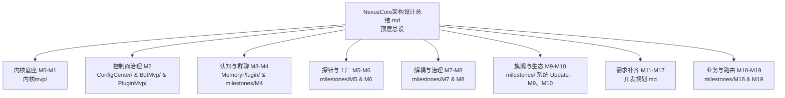

# NexusCore 设计与实现文档全集

本目录汇集了 NexusCore 微内核个人智能工作台的所有系统架构设计、里程碑实现方案、问题清单以及演进规划。

---

## 目录导航图谱

---

## 一、架构总览与基石规范

| 文档 | 说明 | 核心内容 |
| --- | --- | --- |
| [NexusCore架构设计总结.md](NexusCore架构设计总结.md) | **上游顶层总设** | 系统定位、微内核三原语、脑手分离、数据模型、因果链与信封规范 |
| [开发规划.md](开发规划.md) | **工程落地规划** | M0–M19 里程碑、人日估算、退出条件与停线点。进度以文首 2026-11-19 记录为准 |
| [NexusCore设计缺陷评审.md](NexusCore设计缺陷评审.md) | **早期架构缺陷评审** | 针对 Monolith 倾向与边界模糊的历史深度评审（D-01 ~ D-23 源头） |
| [NexusCore已修正问题归档.md](NexusCore已修正问题归档.md) | **已解决问题归档** | D-01 至 D-10、D-13 至 D-23 的具体修正方案与验收记录 |
| [NexusCore待修正问题清单.md](NexusCore待修正问题清单.md) | **未解决问题追踪** | D-11（向量侧表）、D-12（业务载荷 Schema）等持续跟踪项 |

---

## 二、基础底座模块详细设计（M0 - M3）

| 目录/模块 | 对应阶段 | 主要文档 | 核心职责与设计边界 |
| --- | --- | --- | --- |
| [内核mvp/](内核mvp/README.md) | M0 ~ M1 | [内核MVP详细设计.md](内核mvp/内核MVP详细设计.md) | 微内核网关 10 核心模块、PostgreSQL 原生持久队列（SKIP LOCKED）、D-04 四语义 |
| [ConfigCenter/](ConfigCenter/README.md) | M1 ~ M2 | [ConfigCenter详细设计.md](ConfigCenter/ConfigCenter详细设计.md) | 统一期望配置中心（plugin/bot/agent/global）、四阶段审批流、secret_ref 凭据隔离 |
| [BotMvp/](BotMvp/README.md) | M2 | [BotMvp详细设计.md](BotMvp/BotMvp详细设计.md) [Bot职责与Prompt生成规范.md](BotMvp/Bot职责与Prompt生成规范.md) [BotSkill设计所需上下文规范与模板.md](BotMvp/BotSkill设计所需上下文规范与模板.md) | 内核四角色与业务 Bot 规范、Supervisor 进程监管、优雅重启、禁 Shell/禁长思考 |
| [PluginMvp/](PluginMvp/README.md) | M2 | [PluginMvp详细设计.md](PluginMvp/PluginMvp详细设计.md) | 标准清单 manifest.json、两级进程模型（L1 Bot + L2 插件进程）、防 PID 复用 |
| [MemoryPlugin/](MemoryPlugin/README.md) | M3 | [MemoryPlugin详细设计.md](MemoryPlugin/MemoryPlugin详细设计.md) [用户级Bot默认个人记忆架构.md](MemoryPlugin/用户级Bot默认个人记忆架构.md) | Claude Code 四层单体记忆栈、`MEMORY.md` ≤ 200 行铁律约束、Auto Dream 离线整合 |

---

## 三、演进里程碑详细设计（M4–M19）

专篇目录：[milestones/README.md](milestones/README.md)。M11–M17 没有独立详设，范围与验收写在 [开发规划.md](开发规划.md) 和 [系统Update-需求规格.md](milestones/系统Update-需求规格.md)。

| 里程碑 | 设计文档 | 交付内容与关键机制 |
| --- | --- | --- |
| **M4** | [M4-前端工作台.md](milestones/M4-前端工作台.md) | Vue 3 独立前端工作台、网关 SSE 实时流、多 Bot 群聊视区、记忆抽屉一键重启 |
| **M5** | [M5-本地Agent搜寻.md](milestones/M5-本地Agent搜寻.md) | 本地 Agent 资产探测（Claude Code/Codex/Pi-Agent 等）、LocalCLIDriver、防噪音蒸馏闭环 |
| **M6** | [M6-Bot工厂.md](milestones/M6-Bot工厂.md) | 独立插件 `plugin_bot_creator`、预设角色库（Reviewer/Coder/Ops）、蓝图校验、Agent 绑定向导 |
| **M7** | [M7-前端微模块.md](milestones/M7-前端微模块.md) | Vite ESM 动态挂载方案、纯净 Shell、PluginRegistry、微模块代码分割 |
| **M8** | [M8-基础模块与依赖治理.md](milestones/M8-基础模块与依赖治理.md) | 基础模块无头化、接口注册、DAG 拓扑加载、三色标记循环检测、滚动热更 |
| **M9** | [M9-标准群聊与全局UI.md](milestones/M9-标准群聊与全局UI.md) [系统Update-全局UI与沙盒轨迹.md](milestones/系统Update-全局UI与沙盒轨迹.md) [系统Update-需求规格.md](milestones/系统Update-需求规格.md) | **v0.1.0 旗舰版**界面专篇，以及审计定稿的需求规格（冲突时以需求规格为准） |
| **M10** | [M10-工具中心与代批.md](milestones/M10-工具中心与代批.md) | **v0.2.0 演示**：工具与商场微模块、按动作名分档的代批。存储口径已按 M12 修订，不再使用内核授权表 |
| **M11** | [开发规划.md](开发规划.md) | 身份可列举与安装留底。已合入 `7624be4`。回归 `make smoke-m11` |
| **M12** | [开发规划.md](开发规划.md) §M12 | 工具插件目录持久化 Skill、MCP 登记与授权。已验收。回归 `make smoke-m12` |
| **M13–M17** | [开发规划.md](开发规划.md)、[系统Update-需求规格.md](milestones/系统Update-需求规格.md) | 沙箱、下载审批、中台助手、设置与纪事、业务插件接入标准。未开工 |
| **M18** | [M18-业务插件需求规格.md](milestones/M18-业务插件需求规格.md) | 规格 v1.0 定稿，待实现：`plugin_pm`、浏览器/VS Code Ingress、Obsidian 文件查询、Agent 导入增强 |
| **M19** | [M19-模型与执行路由.md](milestones/M19-模型与执行路由.md) | 规格 v1.0 定稿，待实现：可选 `plugin_model_router`，未安装时保持 M6 单 Key |

---

## 四、UI 原型与历史归档

- **[index.html](index.html)**：M9 全局 UI 原型（Nexus Storybook Console），包含白昼童话羊皮纸与午夜古籍主题、双段式分栏与交互演示。
- **[archive/](archive/README.md)**：早期原型立项草稿与原始构想记录文本归档。

---

## 五、设计文档阅读指南

1. **新加入开发者 / 贡献者**：请优先通读根目录 `AGENTS.md`、`README.md`，随后阅读 [NexusCore架构设计总结.md](NexusCore架构设计总结.md)。
2. **开发新插件**：请阅读 [PluginMvp/PluginMvp详细设计.md](PluginMvp/PluginMvp详细设计.md) 与 [milestones/M8-基础模块与依赖治理.md](milestones/M8-基础模块与依赖治理.md)。
3. **开发或修改 Bot**：请阅读 [BotMvp/BotMvp详细设计.md](BotMvp/BotMvp详细设计.md) 与 [milestones/M6-Bot工厂.md](milestones/M6-Bot工厂.md)。
4. **集成工具或 MCP**：先读 [milestones/系统Update-需求规格.md](milestones/系统Update-需求规格.md) 的 R6 / R14 / R16，再读 [开发规划.md](开发规划.md) 的 M12。M10 专篇只保留演示背景，其中的内核授权表方案已废弃。
