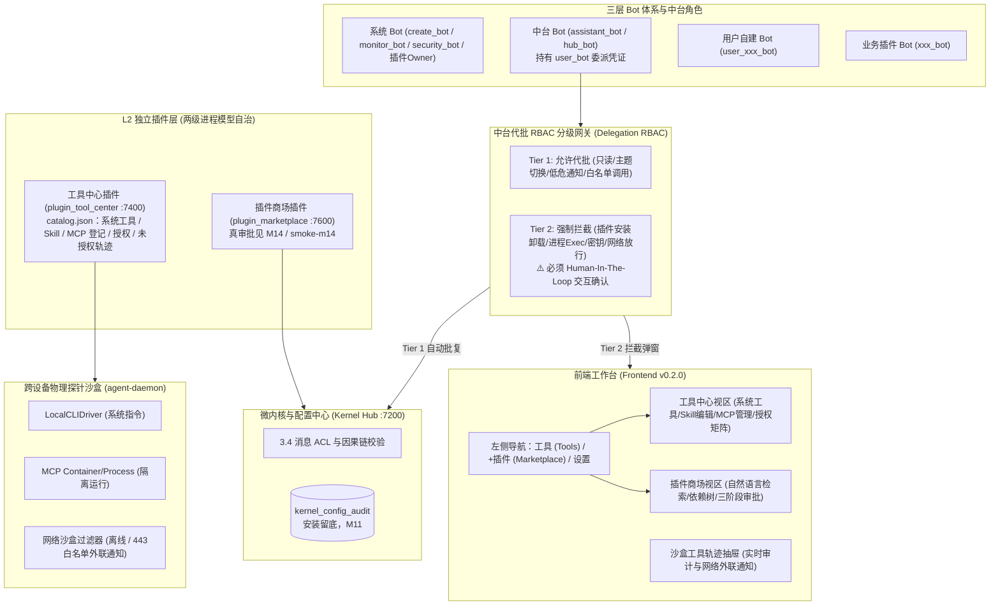

# M10 详细设计定版：工具中心、MCP/Skill 插件化治理与中台 Bot 审批闭环

> **文档状态**：v0.2.0 演示说明。存储与授权口径以 2026-11-19 修订为准  
> **版本标识**：NexusCore v0.2.0 演示；工具持久化在 M12  
> **定版日期**：2026-11-16（2026-11-19 修订存储落点）  
> **修订**：本文初稿把授权、轨迹和安装审计写成内核表。需求规格已否决 `kernel_bot_tool_grants`、`kernel_tool_trajectories`、`kernel_plugin_audit_logs`。M12 起，工具分类、Skill 正文、MCP 登记和 Bot–工具授权在 `plugin_tool_center` 的目录 `catalog.json`。安装留底沿用 M11 的 `kernel_config_audit`。与 [系统Update-需求规格.md](系统Update-需求规格.md) 冲突时以需求规格为准。  
> **核心主题**：工具插件治理不可编辑系统工具、可编辑 Skill 与外部 MCP；授权多对多且搜索默认强绑；中台代批按动作名分档（Tier 2 仍须人工确认）。真审批与代批身份核对留在 M14 / M15。

---

## 1. 业务背景与设计目标

在完成 M9 全局工作台原型（Atelier Code）与内置沙盒工具轨迹审计闭环后，NexusCore 已经具备完备的人机交互界面、群聊协同引擎与任务溯源底座。然而，系统在工具管理、外部协议扩展及自动化授权上亟需规范化体系：
1. **工具分类杂乱缺乏治理**：系统底层物理命令、用户编写的提示词/脚本 Skill、外部基于 Model Context Protocol (MCP) 的三方服务混杂在一起，缺乏统一的增删改查（CRUD）与生命周期管理；
2. **Bot 越权滥用风险**：缺乏标准化的授权矩阵，所有 Bot 理论上均能获知全局工具列表，缺乏“最小特权原则（Principle of Least Privilege）”约束；
3. **微内核纯净化铁律受到挑战**：外部生态协议（如 MCP、社区 Skill）若直接侵入内核，将导致微内核膨胀与崩溃扩散；
4. **自动化审批与安全防线的矛盾**：用户希望中台助手 Bot 能自然语言代办事务，但若完全信任中台 Bot，一旦遭遇 Prompt 注入（Indirect Prompt Injection），黑客或恶意指令即可伪造用户身份安装恶意插件或销毁数据。

为此，M10 战略聚焦于：**工具生态插件化、权限授权矩阵化、中台代批分级化（Tier 1 受控 vs Tier 2 刚性阻断）、插件审批三阶段闭环**。

---

## 2. 总体架构拓扑

---

## 3. 详细设计要点

### 3.1 工具分类治理与独立工具插件（`plugin_tool_center`）

#### 3.1.1 工具三级分类与特征
NexusCore 工具生态严格划分为三类：
1. **不可编辑系统工具（System Native Tools）**：
   - 来源于系统驱动层或本地受控探针（`LocalCLIDriver`），如文件查看、目录树扫描、Git 状态探查；
   - 固化于底层代码，用户/Bot **只可调用、不可修改代码**；
2. **可编辑工具与技能（Editable Skills）**：
   - 允许开发者或用户直接在线创建、编辑与测试；
   - 包含自定义 Python 脚本、Shell 批处理、结构化 Prompt 模板；
   - 支持完整的增删改查（CRUD）与版本快照回退；
3. **外部 MCP 服务工具（External MCP Tools）**：
   - 兼容标准 Model Context Protocol（MCP）协议规范（通过 stdio 或 HTTP/SSE 管道）；
   - **微内核隔离铁律**：**微内核不包含任何 MCP 协议解析与运行时代码**；
   - MCP 服务的进程拉起、stdio 管道交互与生命周期由 `plugin_tool_center` 委托 `agent-daemon` 在沙盒环境中隔离运行，异常崩溃不扩散至内核。

#### 3.1.2 Bot–工具授权（插件目录，不进配置中心）

2026-11-16 初稿写过配置中心表 `kernel_bot_tool_grants`。该方案已废弃。M12 把授权和工具正文放在工具插件目录 `catalog.json`：

- 字段：`grant_id`、`bot_id`、`tool_id`、`permission`（`read_only` / `execute` / `admin`）、`granted_by`、`granted_at`、`status`。
- 系统工具 `editable=false`，更新和删除被拒绝。Skill 修改追加一条版本记录。
- MCP 只存 `endpoint_ref` 与 `secret_ref`（形如 `secret://...`）。明文密钥和 Skill 源码式正文被拒绝。运行在探针侧。
- `sys.search.web` 默认强绑。只有 `named_bots` 里点名的 Bot 能被授予，其余授予返回 403。
- 未授权调用拒绝，并在同一目录留下轨迹。Hub 不保存 Skill 正文；设置 `-tool-center-url` 时只转发。
- 启动参数：`plugin_tool_center -data <目录>`。不设 `-data` 时仍是进程内存，只用于 M10 演示回归。

---

### 3.2 三层 Bot 体系与中台 Bot 代批 RBAC 安全防线

#### 3.2.1 三层 Bot 角色界定
1. **系统 Bot（System Bots）**：
   - 专司系统调度运维（如 `create_bot`、`monitor_bot`、`security_bot` 以及各独立插件的 Owner Bot 如 `groupchat_bot`、`tool_center_bot`）；
2. **中台管家 Bot（Hub Bot / `assistant_bot`）**：
   - 系统的总管家，代表用户在总线调度协调各业务 Bot，用户可授予其代理审批权；
3. **用户自建与业务 Bot（User / Plugin Business Bots）**：
   - 专精特定业务领域的轻量 Agent（如 Reviewer、Coder、Ops、Obsidian 笔记助手），禁 Shell、禁长思考。

#### 3.2.2 分级代批 RBAC（Delegation RBAC）与防注入铁律
为杜绝恶意 Prompt 诱导中台 Bot 滥用权限，构建刚性分级门禁：

| 授权分级 | 包含操作类型 | 处理方式 | 安全保障机制 |
| :--- | :--- | :--- | :--- |
| **Tier 1 (受控代批)** | - UI 主题切换（白昼/午夜/跟随系统） - 系统只读参数查询 - 低危消息中继与群聊拉人 - 白名单内只读/低危工具调用 | **自动代批放行** | 记录代批因果链，审计追踪，触发轻量通知 |
| **Tier 2 (高危一票否决)** | - 插件安装、升级、卸载 - 二进制进程 Exec 与 OS 信号下发 - 密钥/API Token 提取 - 穿透沙盒的网络隔离放行规则 | **绝对禁止代批 强制人类确认** | **Mandatory HITL**：无论中台 Bot 提示词或规则如何配置，直接阻断，必须在终端或前端交互弹出确认框由人类签名！ |

---

### 3.3 插件商场与三阶段安全审批流闭环（`plugin_marketplace`）

插件的全生命周期必须在内核与日志中 100% 留痕，经历三个严格隔离的阶段：

1. **阶段一：下载与静态审查（Download & Static Inspection）**
   - 插件商场助手 Bot（`marketplace_bot`）支持自然语言搜索与依赖解析；
   - 下载二进制与清单，强制校验 `binary_digest`（SHA-256 强一致）；
   - 基于 Kahn 算法构建依赖 DAG，实施依赖环路检测（三色标记 DFS）与依赖深度硬限制（`MaxDepth ≤ 2`）。
2. **阶段二：安装与特权审批（Install & Security Approval）**
   - 生成标准微内核配置提案（Config Proposal），包含权限要求与所申请工具清单；
   - `security_bot` 进行静态合规预审；
   - 触发 Tier 2 高危审批：必须经由真实 `user_bot`（人类用户交互确认）通过，方可写入激活并由 Supervisor 调度拉起。
3. **阶段三：卸载与级联排空（Uninstall & Cascade Teardown）**
   - 依赖反向保护：若当前插件正被上层业务插件依赖，默认阻断单点卸载；
   - 仅在指定 `--cascade` 时，依据逆拓扑序由上至下优雅下线（先停 L2 插件服务，后停 L1 Bot 进程）；
   - 安装、升级、停用、卸载的成败写入已有的 `kernel_config_audit`（M11）。不新建 `kernel_plugin_audit_logs`。

---

### 3.4 沙盒网络策略与工具执行轨迹审计

本节是目标行为。默认离线、搜索外联通知和轨迹里的联网标记由 M13 验收。M12 只记录未授权调用，不把轨迹放进 `kernel` schema。

1. **分级网络隔离策略**：
   - 普通计算/代码/分析工具：容器/进程沙盒默认配置 `network=none`，物理阻断一切 TCP/UDP 外联；
   - 搜索与联网工具（如 `search_web`）：仅放行 443/53 端口受限域名；
2. **主动通知告警**：
   - 任何工具触发网络外联时，沙盒探针实时产生 Ingress 审计事件；
   - 中台 Bot 与前端实时气泡通知：“[网络告警] Bot 'xxx' 正在通过受控沙盒访问外网: api.search.org”，用户可一键熔断。

---

## 4. 落地步骤与工程排期

1. **阶段 1：工具模块与插件存储（M10 演示，M12 落盘）**
   - `internal/modules/toolcenter/` 无头模块做分类、授权校验和代批分档。
   - 不扩展配置中心，不建 `kernel_bot_tool_grants`。持久化由插件 `-data` 目录完成（M12，`make smoke-m12`）。
2. **阶段 2：中台代批 RBAC 网关与安全防线（Day 4 - Day 6）**
   - 实现 Tier 1 vs Tier 2 审批裁决引擎，注入 Prompt 越权渗透自动化测试；
   - 落地 `assistant_bot` / `hub_bot` 委派调度逻辑。
3. **阶段 3：独立插件实现（Day 7 - Day 9）**
   - 实现独立插件 `plugins/plugin_tool_center/`（提供 `:7400` API）；
   - 实现独立插件 `plugins/plugin_marketplace/`（提供 `:7600` API。不带 `-data` 时仍是 M10 演示；真 checksum 批准由 M14 / `make smoke-m14` 验收）。
4. **阶段 4：前端微前端视区与商场/工具交互集成（Day 10 - Day 11）**
   - 前端集成工具中心管理视图（系统工具/可编辑 Skill CRUD/授权矩阵）；
   - 前端集成插件商场与审批中心视图；
   - 左侧两段导航“工具”与“+ 插件”路由联调打通。
5. **阶段 5：全链路端到端自动化冒烟验收（Day 12 - Day 14）**
   - 编写 `scripts/smoke-m10.sh` 与 `make smoke-m10`，全绿通过并更新规划。
