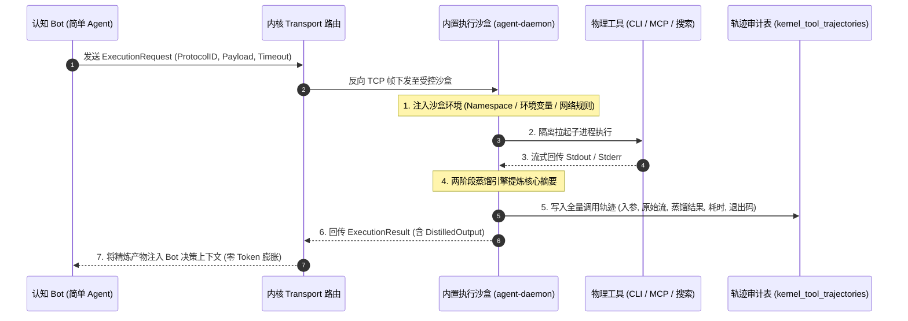

# NexusCore 系统 Update 详细设计：全局 UI 页面原型、内置沙盒工具轨迹审计与生态治理规范

> **文档版本**：v1.0 (Approved & Finalized)  
> **编制日期**：2026-11-16  
> **关联原型**：[doc/index.html](file:///home/yhy/Projects/NexusCore/doc/index.html)（高保真交互控制台）、手绘线框原型  
> **核心主题**：承接系统全局 Update 需求，正式确立**“左侧两段式分栏 + 右侧 `@xxx| 输入框`”**的主界面交互体系；全面落地**“内置沙盒记录 Bots 使用工具轨迹”**的核心机制；明确三层 Bot 体系、四类插件生态、工具分类与下载/安装/卸载三阶段安全审批闭环。

---

## 1. 核心设计原则与架构定位

在经历 M1~M8 核心内核、进程生命周期、无头基础模块与 DAG 拓扑依赖治理之后，NexusCore 进入向**完整个人智能操作系统**跃升的关键节点。本次 Update 确立以下四大基石原则：

1. **脑手分离铁律（Brain-Hand Separation）**：
   - Bot 永远是轻量纯认知实体，禁止长时间思考，禁止直接执行本地系统 Shell。
   - 所有外部物理操作、CLI 调用、搜索与环境变更，必须经微内核 Transport 路由下发给受控探针（`agent-daemon`）执行。
2. **沙盒核心定位：工具执行轨迹的受控留痕器（Trajectory Logger）**：
   - **内置沙盒不仅仅是安全防护墙，更是全量捕获并审计 Bots 工具调用轨迹的唯一受控容器**。
   - 所有工具调用的入参、终端原始输出帧、退出状态码、执行耗时、网络外联行为均被完整落盘，作为因果链审计与单体记忆自动整合（Auto Dream）的第一手溯源事实。
3. **极简居中的“唤醒即交互”界面模型**：
   - 左侧上下两段分栏：系统运作纪事（日志、数据、定时任务） vs 伙伴与生态工坊（agents、bots、工具、+ 插件）。
   - 右侧主舞台以 `@xxx| 输入框` 为核心，通过胶囊 Mention 实现自然语言编排一切 Bot、Agent 与工具。
4. **安全防线不可越位（Strict HITL & RBAC）**：
   - 中台 Bot（Hub Bot）使用 `user_bot` 身份入总线协助用户调度，但**严格限制代批范围**：低危/只读类操作可受控代批，高危可执行类操作（插件安装卸载、二进制执行、提权、穿透沙箱）必须由人类在终端或界面显式确认。
   - 内核不存 MCP/Skill 代码与业务数据，工具插件负责工具解析，沙箱探针负责进程拉起。

---

## 2. 全局 UI 页面原型规范（参考 doc/index.html）

基于手绘线框图与 `doc/index.html` 高保真原型，系统前端工作台采用统一的**童话绘本与工坊风（Atelier Code）**设计语言，并原生支持白昼羊皮纸、午夜星空与系统跟随三套主题。

### 2.1 整体界面拓扑布局

```text
+------------------------+-------------------------------------------------------+
|  Nexus Atelier Code    |  [☀️/🌙/💻] 主题切换                                    |
|                        |                                                       |
|  [Chronicles · 纪事]   |                                                       |
|  - 日志 (含沙盒轨迹)   |                   今天想谱写哪一段工坊指令？          |
|  - 数据 (记忆/图谱)    |          输入 @ 召唤你的 Agent、Bot 或工具，像翻阅绘本一样编排 |
|  - 定时任务 (Cron)     |                                                       |
|------------------------|                 +-----------------------------------+ |
|  ✦ (星芒分界线)        |                 | [@xxx]  输入框...                 | |
|------------------------|                 |-----------------------------------| |
|  [Companions · 工坊]   |                 | [@ 提及目标] [⚡ 沙盒工具轨迹] [执行]| |
|  - agents (探针)       |                 +-----------------------------------+ |
|  - bots (自建/业务)    |                                                       |
|  - 工具 (MCP/Skill)    |         [@coder 检查构建]  [@cron-herald 晨间早报]    |
|  - [+ 插件] (市场)     |                                                       |
|                        |   📖 当前翻阅章节：agents — 已唤醒 4 位受控智能体      |
+------------------------+-------------------------------------------------------+
```

### 2.2 左侧边栏两段式分区说明

| 分区 | 模块名称 | 路由与功能定义 | 交互行为 |
| :--- | :--- | :--- | :--- |
| **上半区：纪事 (Chronicles)** | **日志 (Logs)** | `/logs`：系统运行日志、任务队列状态，**点击直接滑出“内置沙盒工具使用轨迹抽屉”**。 | 支持关键词过滤、级别筛选、查看因果链追踪。 |
| | **数据 (Data)** | `/data`：Claude Code 式单体记忆库（Transcripts / Notes / Representations / MEMORY.md）、知识图谱。 | 可视化树状浏览、搜索与导出。 |
| | **定时任务 (Cron)**| `/cron`：晨间自动化简报、夜间 Auto Dream 离线整合、系统自动巡检任务。 | 支持自然语言配置、启停与执行历史。 |
| **中线** | **星芒分界线** | 手绘风水平分割线，明确界定“系统后台运作”与“前台伙伴工坊”。 | 纯视觉引导。 |
| **下半区：工坊 (Companions)** | **agents** | `/agents`：本地物理探针（Claude Code / Codex / pi / loopback 等 CLI 驱动）。 | 探针健康监控、能力清单（Capabilities）、参数配置。 |
| | **bots** | `/bots`：三层 Bot 清单（系统 Bot、中台 Bot、用户自建 `user_xxx_bot`、业务插件 Bot）。 | 点击滑出画像与单体记忆抽屉（严格 ≤200 行约束，一键重启生效）。 |
| | **工具 (Tools)** | `/tools`：系统内置服务工具、可编辑 Skill、外部加载的 MCP 工具箱。 | 多对多授权矩阵维护、参数调试、编辑与新增。 |
| | **+ 插件 (Plugins)**| `/market`：插件商场、本地插件安装与审批流。 | 点击弹出“插件商场与安装审批向导”。 |

### 2.3 右侧主舞台 `@xxx| 输入框` 交互契约
1. **胶囊 Mention（Mention Pill）**：
   - 默认展示 `@xxx` 标签，输入键入 `@` 触发智能候选 Popover（自动聚合 agents、bots、工具）；
   - 点击选项立即将选中对象以胶囊形式吸附在输入行头部，支持 `Backspace` 快速删除；
2. **快捷工坊指令（Quick Tales）**：
   - 下方提供一键填充的常用自然语言卡片（如 `@coder 检查构建`、`@cron-herald 设定巡检`）；
3. **沙盒轨迹快捷呼出**：
   - 输入框工具条常驻 `[⚡ 沙盒工具轨迹]` 按钮，随时展开右侧抽屉，实时观察 Bot 调度工具的执行轨迹。

---

## 3. 内置沙盒工具轨迹记录体系（Tool Trajectory Sandboxing）

### 3.1 核心目标：受控隔离 + 毫秒级全程留痕
用户在需求中明确强调：**“内置沙盒是为了记录 bots 使用工具轨迹”**。在 NexusCore 中，沙盒的职责由传统被动的“限制容器”升级为主动的**“轨迹留痕与认知提炼中心”**：



### 3.2 沙盒网络分级限制机制（Network Sandbox Policy）
为防止恶意工具外联横向渗透，内置沙盒实施刚性网络隔离策略：
1. **默认策略（Offline by Default）**：
   - 所有常规执行工具（Bash 脚本、本地 Git、代码编译器、文件操作、本地 CLI）在沙盒内执行时，网络模式强制为 `network=none`，严禁任何入站与出站连接；
2. **白名单受控放行（Restricted Egress for Search）**：
   - 只有显式声明 `tool_type='internet_search'` 的受控搜索工具，允许放行 DNS (Port 53) 与 HTTPS (Port 443)；
   - **调用感知与通知铁律**：沙盒在放行搜索外联流量时，强制向微内核 Ingress 投递审计事件，通知用户或中台 Bot：“检测到 Bot 正在调用互联网检索工具，目标域名: ...”，保障完全透明留痕。

### 3.3 轨迹数据模型与落盘 Schema（`kernel_tool_trajectories`）

```sql
CREATE TABLE IF NOT EXISTS kernel.kernel_tool_trajectories (
    trajectory_id       BIGINT GENERATED ALWAYS AS IDENTITY PRIMARY KEY,
    traceparent         VARCHAR(128) NOT NULL,            -- W3C 因果链追踪标识
    bot_id              VARCHAR(64) NOT NULL,             -- 发起调用的 Bot ID
    tool_id             VARCHAR(64) NOT NULL,             -- 目标工具/协议标识
    tool_type           VARCHAR(32) NOT NULL,             -- builtin | probe_cli | mcp | skill
    sandbox_id          VARCHAR(64) NOT NULL,             -- 执行沙盒实例唯一标识
    network_policy      VARCHAR(32) NOT NULL,             -- offline | search_allowlist
    input_payload       JSONB NOT NULL,                   -- 调用的完整参数
    exit_code           INT NOT NULL,                     -- 进程执行退出码
    raw_output_ref      VARCHAR(256),                     -- 原始大日志存储引用 (不进入 Bot 上下文)
    distilled_output    TEXT NOT NULL,                    -- 蒸馏后的精炼文本 (专供 Bot 决策)
    duration_ms         INT NOT NULL,                     -- 执行耗时 (毫秒)
    executed_at         TIMESTAMPTZ NOT NULL DEFAULT now()
);

CREATE INDEX idx_trajectories_bot ON kernel.kernel_tool_trajectories(bot_id, executed_at DESC);
CREATE INDEX idx_trajectories_trace ON kernel.kernel_tool_trajectories(traceparent);
```

---

## 4. 全新三层 Bot 体系与中台 Bot 代理审批边界

### 4.1 三层 Bot 分类模型

```text
               +---------------------------------------------------+
               |                    人类用户 (User)                 |
               +---------------------------------------------------+
                                         │
                   ┌─────────────────────┴─────────────────────┐
                   ▼                                           ▼
       ┌───────────────────────┐                   ┌───────────────────────┐
       |    中台 Bot (HubBot)   |                   |  用户自建 Bot (UserBot) |
       | 代理执行/中继协调/分级代批 |                   | user_xxx_bot 专属记忆  |
       └───────────────────────┘                   └───────────────────────┘
                   │                                           │
       ┌───────────┴───────────────────────────────────────────┴───────────┐
       ▼                                                                   ▼
┌───────────────────────────────┐                   ┌───────────────────────────────┐
|      系统 Bot (System Bots)    |                   |    业务插件 Bot (Plugin Bots)  |
| user_bot / create_bot / ...   |                   | xxx_bot 自然语言驱动插件能力    |
└───────────────────────────────┘                   └───────────────────────────────┘
```

1. **系统保留 Bot（Kernel-Level System Bots）**：
   - 固化保留名：`user_bot`（人类代表）、`create_bot`（实例创建决策）、`monitor_bot`（健康巡检）、`security_bot`（安全决策）；
   - 任何插件不得注册同名 Bot，享有内核核心原语受控调用权。
2. **中台助手 Bot（Hub Assistant Bot）**：
   - **定位**：系统级常驻调度助理，以 `user_bot` 的委派身份进入总线，协调其余 Bot 工作；
   - **分级代批授权体系（Delegation RBAC）**：
     - **允许受控代批（Tier 1）**：UI 主题切换、读取低危参数、查询探针状态、调度已获得预审白名单的只读工具；
     - **严禁代批铁律（Tier 2 - Mandatory HITL）**：**插件安装与卸载、本地二进制 Exec、敏感凭证提取、突破沙箱网络规则**。此类请求无论中台 Bot 如何配置，必须由人类用户在交互终端显式输入确认。
3. **用户自建 Bot（User-Derived Bots, `user_xxx_bot`）**：
   - 命名规范：`user_<name>_bot`；
   - 由用户在 Bot 工厂按需派生，具备独立 Persona、System Prompt，严格挂载四层单体记忆栈（`MEMORY.md` ≤ 200 行硬约束）；
   - 勾选绑定允许调用的物理 Agent 探针（`allowed_agents`）与工具授权。
4. **业务插件 Bot（Plugin Business Bots, `xxx_bot`）**：
   - 命名规范：`<plugin>_bot`（如 `pm_bot`, `wiki_bot`, `video_edit_bot`）；
   - 充当业务插件的自然语言交互枢纽，将用户的模糊会话解析为该插件领域的专业工具调用链。

---

## 5. 插件分类、基础功能与两级生命周期

### 5.1 四类插件架构规范
微内核将插件明确划分为四种类型，在清单 `manifest.json` 中静态声明：

| 插件类型 (`plugin_type`) | 职责范围 | 是否必须包含 L2 进程 | 是否必须注册系统 Bot | 典型示例 |
| :--- | :--- | :---: | :---: | :--- |
| **`business` (业务插件)** | 完整业务领域解决方案（看板、双链笔记、剪映、SSH、Wiki、浏览器）。 | 是（必须独立运行并监听端口） | 是（拥有专职业务 Bot） | `plugin_pm`, `plugin_notes`, `plugin_browser` |
| **`tool` (工具插件)** | 专职提供可复用系统工具、Skill 扩展、外部 MCP Server 宿主。 | 视实现而定 | 否（通过工具授权表注入给其他 Bot） | `plugin_tool_manager`, `plugin_search` |
| **`theme` (主题插件)** | 全局前端样式、字体、微模块视觉规范、白昼/午夜配色包。 | 否（仅前端 ESM 模块） | 否 | `plugin_theme_storybook` |
| **`bot_pack` (Bot 模板库)** | 预定义的专家角色蓝图库（Reviewer、Architect、SRE Ops）。 | 否（仅配置中心蓝图数据） | 否 | `plugin_presets_coder` |

### 5.2 五大原生内置基础功能插件
系统开箱即用集成五大基础功能，各自实现自治微前端 UI：
1. **Agents 资产插件 (`plugin_agent_discovery`)**：本地 CLI 探针资产扫描与版本监控；
2. **Bots 治理插件 (`plugin_bot_creator`)**：Bot 蓝图工厂向导与 ≤200 行单体记忆抽屉；
3. **插件商场插件 (`plugin_marketplace`)**：插件浏览、依赖风险检测、自然语言一键生成安装提案；
4. **工具中心插件 (`plugin_tool_center`)**：工具展示、可编辑 Skill 调试、MCP Server 管理、Bot-Tool 授权表维护；
5. **系统设置插件 (`plugin_settings`)**：语言、主题切换、系统级环境变量与插件级联卸载。

---

## 6. 工具分类治理与下载/安装/卸载三阶段审批流

### 6.1 工具分级与存储边界
- **可编辑工具（Editable Tools / Skills）**：包含用户或插件自定义的 JavaScript / Python 简易脚本、Prompt 模板工具，支持在前端工具中心进行在线查看与参数微调；
- **不可编辑工具（Immutable / Built-in Tools）**：系统底层物理驱动、探针受控 CLI、微内核服务，代码硬编码打包，禁止运行时篡改；
- **MCP / Skill 边界隔离**：内核配置中心只维护工具的元数据契约（ID、Name、InputSchema、ApprovalPolicy），**绝对不直接存储或编译 MCP/Skill 代码**，代码解析与生命周期完全交由独立的工具管理插件负责。

### 6.2 下载、安装、卸载三阶段安全审批闭环

```text
[ 1. 下载阶段 (Download) ]
    │
    ▼
SHA-256 Digest 校验 ───> 依赖 DAG 构建 ───> 环路检查 (三色DFS) ───> 最大层级校验 (MaxDepth <= 2)
                                                                            │
                                                                            ▼
                                                                [ 2. 安装审批阶段 (Install) ]
                                                                            │
                                                                            ▼
                                                生成配置提案 (Proposal) ──> security_bot 预审
                                                                            │
                                                                            ▼
                                                      user_bot / 真实终端显式批准 (Approve)
                                                                            │
                                                                            ▼
                                                      激活入库 (Activate) ──> Kahn 拓扑排序加载
                                                                            │
                                                                            ▼
[ 3. 卸载审批阶段 (Teardown) ] <── 逆拓扑级联下线 (Cascade) <── 反向依赖校验 (拒绝单点卸载)
```

1. **下载审批阶段**：校验二进制/资源包 Hash，静态扫描依赖项，确保不破坏系统层级；
2. **安装审批阶段**：严格走微内核配置中心标准四阶段流（Proposal -> Security -> User -> Active），禁止 Bot 自批；
3. **卸载审批阶段**：存在下游业务依赖时强行拒绝（409 保护）；用户确认 `--cascade` 后按逆拓扑序由上至下受控停机。

---

## 7. 文档更新与实施归档总结

- **原型文件已就绪**：[doc/index.html](file:///home/yhy/Projects/NexusCore/doc/index.html) 已全面集成左侧上下两段导航、右侧居中 `@xxx| 输入框`、内置沙盒工具使用轨迹抽屉、白昼/黑夜主题切换；
- **架构审计已闭环**：确立脑手分离、沙盒轨迹留痕、中台 Bot 代批边界（严禁代批高危可执行类操作）、MCP/Skill 内核解耦四大核心安全红线；
- **为 M9/M10 提供标准输入**：本详设文档作为后续全局 UI 整合与工具中心开发的基础契约标准。
